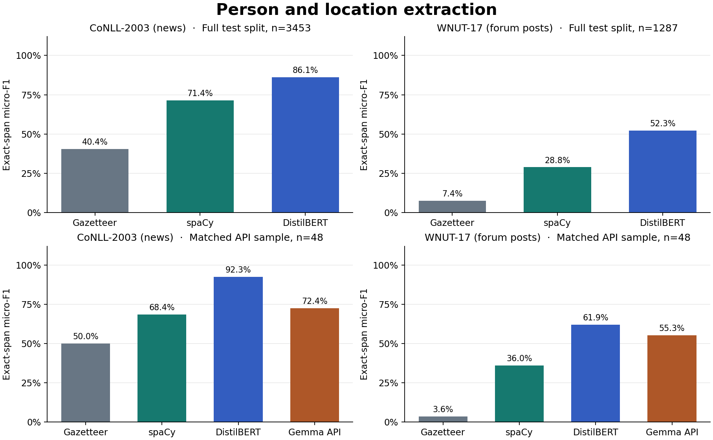

# 第七周实验报告 · 英文人名和地名抽取

## 任务与数据

从英文文本中抽取人名（`PER`）和地名（`LOC`），比较词典、预训练 NER 模型和通用模型 API 在不同文本上的表现。每个实体表示为 `(起始字符, 结束字符, 类别)`，结束字符位置采用开区间。起点、终点和类别全部命中才算正确。以实体级 micro Precision、Recall 和 F1 评分，边界截短或类别错误会各产生一次误报和一次漏报。

| 数据 | 文本来源 | 测试记录 | PER | LOC |
|---|---|---:|---:|---:|
| CoNLL-2003 | Reuters 英文新闻 | 3,453 | 1,617 | 1,668 |
| WNUT-17 | Reddit 和 StackExchange 等论坛文本 | 1,287 | 429 | 150 |

词典使用 CoNLL 官方训练集的 14,041 条记录。两套官方测试集保留样本原有顺序，输入都由发布的 token 用空格连接，保留大小写及标点。将 WNUT 的 `person` 和 `location` 对应到 `PER` 和 `LOC`，其余类别不纳入评分。两套语料对地名范围、头衔和实体边界的标注规范存在差异。数据和标签出处见 [CoNLL 论文](https://aclanthology.org/W03-0419/)、[CoNLL 数据版本](https://huggingface.co/datasets/lhoestq/conll2003) 和 [WNUT 官方任务页](https://noisy-text.github.io/2017/emerging-rare-entities.html)。

## 四种方法

| 方法 | 实现与设置 |
|---|---|
| 训练集词典 | 从训练标签统计实体短语，按不区分大小写的最长词序列匹配。跨类别时保留频数最高的类别，平票舍弃。 |
| spaCy | `en_core_web_sm` 3.8.0，只启用 `tok2vec` 与 `ner`。将 `PERSON` 映射为 `PER`，`GPE` 和 `LOC` 映射为 `LOC`。 |
| DistilBERT | `dslim/distilbert-NER`，用 Transformers token classification API。用 `first` 先按词聚合子词，再合并 BIO 标签，同一权重的 `simple` 聚合作为额外对照。 |
| Gemma HTTP API | 本机 Ollama 0.40.17 的 `/api/generate`，运行 `gemma4:e2b`，温度为 0，关闭思考，每批四条。用 JSON Schema 约束回包，并将逐字复制的实体字符串映射回输入字符位置。 |

Gemma 抽样使用固定种子 `20261127`，从每套测试集无放回均匀抽取 48 条，三种本地方法在完全相同的样本上重算分数。API 输出中的实体按大小写精确匹配原文，多次出现时回填到同一短语的各处。无法定位的输出会被舍弃并计数。设置与样本 ID 已随作业提交。[spaCy 模型文档](https://spacy.io/models/en/) · [DistilBERT 模型卡](https://huggingface.co/dslim/distilbert-NER) · [Gemma 模型页](https://ollama.com/library/gemma4:e2b) · [Ollama 结构化输出文档](https://docs.ollama.com/capabilities/structured-outputs)

## 实测结果

### 完整测试集

| 数据 | 方法 | Precision | Recall | Micro-F1 |
|---|---|---:|---:|---:|
| CoNLL-2003 | 训练集词典 | 33.86% | 49.98% | 40.37% |
| CoNLL-2003 | spaCy | 75.95% | 67.31% | 71.37% |
| CoNLL-2003 | DistilBERT | 82.26% | 90.23% | **86.06%** |
| WNUT-17 | 训练集词典 | 5.74% | 10.36% | 7.39% |
| WNUT-17 | spaCy | 29.02% | 28.67% | 28.84% |
| WNUT-17 | DistilBERT | 58.14% | 47.50% | **52.28%** |

### 四种方法的同样本对比

| 数据 | 方法 | Precision | Recall | Micro-F1 |
|---|---|---:|---:|---:|
| CoNLL-2003 | 训练集词典 | 48.78% | 51.28% | 50.00% |
| CoNLL-2003 | spaCy | 70.27% | 66.67% | 68.42% |
| CoNLL-2003 | DistilBERT | 92.31% | 92.31% | **92.31%** |
| CoNLL-2003 | Gemma HTTP API | 57.58% | 97.44% | 72.38% |
| WNUT-17 | 训练集词典 | 3.03% | 4.55% | 3.64% |
| WNUT-17 | spaCy | 32.14% | 40.91% | 36.00% |
| WNUT-17 | DistilBERT | 65.00% | 59.09% | **61.90%** |
| WNUT-17 | Gemma HTTP API | 52.00% | 59.09% | 55.32% |

## 差异和误差分析

- **词典跨语料时覆盖下降。** WNUT 的 579 个金标实体中，517 个在训练词典里没有匹配短语，词典对此组召回率为 0，spaCy 为 23.98%，DistilBERT 为 43.91%。CoNLL 中相同定义下，DistilBERT 在词典未覆盖的 1,636 个实体上找对了 1,488 个。
- **子词合并影响精确边界。** 同一 DistilBERT 权重使用 `simple` 策略时，会把 `Nadim Ladki` 切成 `Na`、`di`、`m Ladki`；`first` 策略恢复了完整人名。CoNLL 和 WNUT 的完整集 F1 分别从 39.38% 和 22.55% 提升到 86.06% 和 52.28%。仅有边界偏差的漏报分别从 1,270 降到 144、从 164 降到 38。WNUT 的 `Gurez sector` 仍被 DistilBERT 截为 `Gurez`，说明词内修正只能解决一部分跨度问题。[子词对照结果](results/wordpiece_ablation.json)
- **Gemma 的高召回伴随更多误报。** 在 48 条 CoNLL 样本上，Gemma 命中 38 个金标实体、误报 28 个；DistilBERT 命中 36 个、误报 3 个。WNUT 上两种方法均命中 13 个，Gemma 误报 12 个，DistilBERT 误报 7 个。WNUT 样本 `wnut-test-1058` 中，Gemma 漏掉地点 `Fly Community Theater`，并把作品名中的词组标为地点。24 批 API 调用均正常结束，存在 2 个无法在 WNUT 输入中定位的返回实体。[API 运行记录](results/api_run.json)
- **样本范围影响可得出的结论。** 按记录配对重抽样 2,000 次，CoNLL 同样本上 DistilBERT 比 Gemma 高 19.93 个 F1 百分点，95% 百分位区间为 `[9.47, 34.47]`。WNUT 差 6.59 个百分点，区间为 `[-10.28, 24.91]`，数据不足以判定谁稳定领先。两个同样本子集各有 39 和 22 个金标实体，WNUT 子集只有 2 个地名。[配对区间](results/paired_bootstrap.json) · [样本编号](results/api_sample_ids.json)

## 运行开销与局限

| 测试集 | 词典 CPU | spaCy CPU | DistilBERT CPU |
|---|---:|---:|---:|
| CoNLL-2003 完整集 | 0.06 秒 | 7.67 秒 | 52.11 秒 |
| WNUT-17 完整集 | 0.03 秒 | 3.43 秒 | 35.46 秒 |

CPU 计时在 AMD Ryzen 7 7745HX 上完成，包含输入处理、模型推理和跨度转换，模型已预热，DistilBERT 使用 4 个 CPU 线程。Gemma 96 条样本的本机 HTTP 总耗时约 69.33 秒，包含首次加载和请求开销，运行路径及样本量与上表不同。计时仅记录本次运行。[CPU 记录](results/core_run.json) · [API 记录](results/api_run.json)

DistilBERT 曾用 CoNLL-2003 微调，新闻分数属于同语料基准，论坛分数反映跨语料迁移。官方 CoNLL 测试集中有 126 条重建文本和训练集完全一致。去除这些测试记录后，词典、spaCy 和 DistilBERT 的 F1 分别为 40.32%、71.43% 和 86.04%，排名相同。复核仅比较完整文本，近重复和预训练语料重合尚未测量。两套数据的标注偏好也会影响结果，按记录重抽样未建模同一文档内的相关性。[排除训练集同文记录后的指标](results/without_train_text_matches.json) · [复核日志](results/verification.txt)
