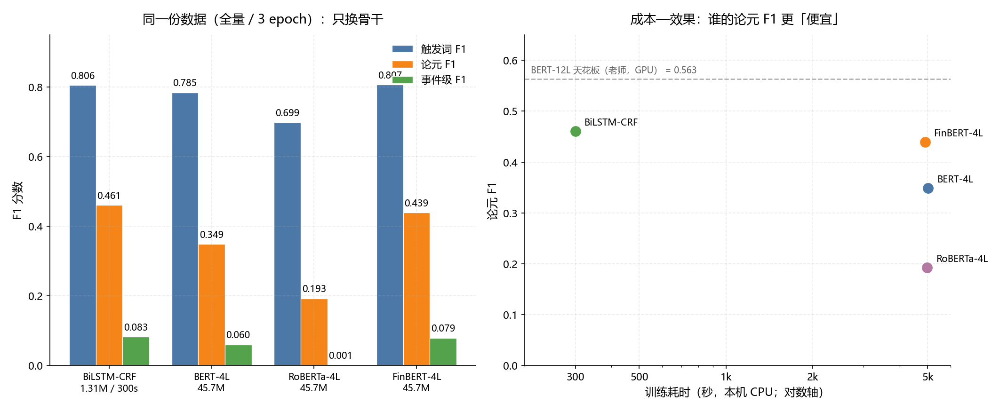
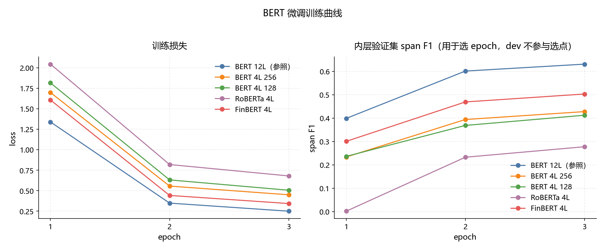

# Week 7 信息抽取：多方法 / 多骨干对比实验报告

> 同一评测口径下，分别动「数据量、层数、截断长度、预训练骨干、模型族」这五个旋钮，
> 回答一个问题：**在纯 CPU、无 GPU 的约束下做金融公告事件抽取，机器和时间该花在哪里。**
>
> **第一次打开请先看 `code/交付说明.md`**：里面按"5 分钟 / 15 分钟 / 想核过程 / 想复现"四档写清了该打开哪份、看哪几节。
>
> **配套文档**：结论与论证＝本文；工程实现 / 全部命令 / 踩坑＝`code/NOTES_myexp.md`；逐条实验的「判断与决策」＝`code/EXPERIMENTS.md`。

| 项目 | 内容 |
|---|---|
| 任务 | 中文金融公告**事件抽取**（触发词识别 + 论元角色填充） |
| 数据 | `data/processed`：训练 5173 / 内层验证 574 / 评测 dev 930 句 |
| 标签体系 | 联合标注 149 标签 = `O` + 2×（13 类触发 + 61 个去重论元角色） |
| 硬件 | 本机 Windows + CPU（`peak_gpu_mb` 全程 0，**未使用任何 GPU**） |
| 实验数 | **9 次训练**（E02~E10）+ 1 次零训练复评（E10b）→ **11 组可比结果**（含 E01 规则基线）+ 老师基线参照 |
| 报告日期 | 2026-11-25 |

## 0. 结论先行

| # | 结论 | 关键数字 |
|---|---|---|
| 1 | **评测链路可信**（双向复现老师结果） | BERT 侧论元 F1 差 **0.0006**；BiLSTM 侧差 **0.25 点** |
| 2 | **训练量是硬门槛，不是调参问题** | 69 步 → 486 步，论元 F1 从 **0.0000 → 0.3489** |
| 3 | **砍层数是伤害最大的一刀** | 老师同环境 12 层 0.5630 → 4 层 **0.3495**，**−21.35 点**；本机复现的 4 层 0.3489 与之只差 **0.0006** |
| 4 | **换领域语料（+9.0）远优于换架构（−15.6）** | FinBERT 0.4390 vs RoBERTa 0.1927 |
| 5 | **性价比冠军是从零训练的 BiLSTM-CRF** | 1.31M 参数 / 300s / 3.92ms，论元 F1 **0.4609** |
| 6 | **每类实例 <50 必崩，加总数据量救不了长尾** | `被约谈` 11 例 → F1 0.1667 / 0.0000 / 0.0000 |
| 7 | **CRF 买精度，不买合法性；治非法只能靠硬约束** | 4 层加 CRF 论元 **+3.51**，但非法率只从 86.1% 到 84.6%；硬约束 0 训练把非法压到 **6.1%**、论元 **+14.46** |

一句话选型：**要最高论元 F1 → 4 层 + CRF + 硬约束（0.5286，约 95 分钟训练）；要性价比 → BiLSTM-CRF（0.4609，5 分钟、1/35 参数）；要类型判别和召回 → FinBERT-4L；要天花板 → 给足 12 层或上 LLM 微调；只做事件发现 → 4 层 + max_len 128。**

## 1. 实验设计

### 1.1 为什么这样设计

对比实验最容易犯的错是"一次改三个变量，然后归因给其中一个"。所以 **E05~E08 严格遵守单变量原则**：每组只改一个旋钮，其余完全照抄基线。

**E09 是例外，必须单独声明**：它把骨干（BERT → 字符级 BiLSTM）、预训练（有 → 无）、解码器（Linear → CRF）、层数（4 层 Transformer → 1 层双向 LSTM）一次全换了，属于"换整个模型族"的对照，**只能回答"从零小模型能不能打"，不能归因到其中任何一个变量**。E01（规则）同样是独立参照，不是单变量组。

| 组 | 改什么 | 相对谁 | 目的 |
|---|---|---|---|
| E01 | —（规则基线） | — | L0 下限，验证词典+正则的天花板 |
| E02–E04 | 数据量 / 轮数 / max_len | myexp 800 句 | 诊断 F1=0 的真因 |
| E05 | —（换全量数据） | 老师 4 层配置 | **环境校准**，逐项对照 |
| E06 | 骨干 BERT → RoBERTa | E05 | 换架构值不值 |
| E07 | max_len 256 → 128 | E05 | 截断的代价与收益 |
| E08 | 骨干 BERT → FinBERT | E05 | 换领域语料值不值 |
| E09 | 整个模型族（BERT/Linear/4 层 → BiLSTM/CRF/从零） | E05 | 从零训练能不能打（**非单变量**） |
| E10 | 解码器 Linear → CRF | E05 | 转移约束值不值那份成本（**严格单变量**） |
| E10b | 上者 + 解码期硬约束（0 训练） | E10 | 后处理能把非法和 F1 救回到哪 |

E06/E07/E08/E09 与 E05 的差异**只有一个字段**，从命令就能直接看出来（见附录 A）。

#### 一处必须交代的取舍：我没把"最优骨干"和"最优解码"叠在一起

标准序贯（也是工业上常见的顺序）是：**定评测口径 → 强基线 → 用小规模扫超参 → 定骨干 → 在定好的骨干上比解码/后处理 → 最后做叠加验证，交付的就是叠加后的配置**。

我的实际顺序是：规则 → 数据量诊断 → 基线复现校准 → 长度消融 → **骨干对比**（RoBERTa / FinBERT）→ **解码对比**（CRF / 硬约束）。最后两步回到 BERT-4L，而不是在 FinBERT 上做。三个理由，都要如实写：

1. **可比性优先**：老师的 CRF 组（`bert_crf_256` 0.5815、`bert_crf_256_hard` 0.6566）用的是 bert-base。在 BERT 上做 CRF，才有"同环境、同骨架"的天花板参照；换成 FinBERT 就没有参照，结论会退化成"我比一个我自己造的基线好"。
2. **单变量可归因**：E10 要回答的是"CRF 值多少点"。若同时换骨干，那 +3.5 点里有多少来自 CRF、多少来自领域语料就无法拆开——这正是本报告其余部分极力避免的错误。
3. **成本**：CPU 上 FinBERT 一轮 4894s，加 CRF 再 +13%、加硬约束再 80s ≈ 1.6 小时，当时已是深夜。

**代价必须写明**：因此本报告测的是**两个维度各自的收益**，**没有测它们的交互**。把 CRF 与硬约束视为近正交（CRF 作用于标签转移、硬约束作用于合法空间，都不依赖骨干），所以单维结论是成立的；但**"最终交付配置"按理应该是 FinBERT-4L + CRF + 硬约束**，而本报告的 0.5286 只是这条路径上的一个中途点。

**粗估（只作量级参考，不可当结论）**：FinBERT linear 0.4390 + CRF 约 +3.5（BERT 上实测）+ 硬约束约 +14（FinBERT 非法率 84.30% 与本机 BERT 的 86.13% 几乎相同，收益大体可平移）→ **0.58~0.61**，会超过老师 12 层 linear（0.5630）并接近其 12 层 CRF（0.5815）。叠加不是相加，真实值只能靠跑，见 §8。

### 1.2 评测口径

全部方法用同一份 `common/evaluate_events.py`、同一份 dev 930 句、同一套匹配规则：

- 触发词：**类型 + 触发词文本**完全一致才算对（不校验 offset）
- 论元：**角色名 + 论元文本**完全一致才算对
- 事件级：类型 + 全部论元 + 边界全对，才算一个事件正确
- 类型 macro F1：13 类各自算 F1 再平均（防止大类刷分）

> 评测在**字符层**进行，所以不同分词器 / 词表的模型可以直接比。

> **全文数据来源约定（读表前请先看这一条）**：**未标注来源的数字 = 本机 CPU 实测**；标注"老师（GPU）"的数字 = 老师原件结果，**只用于 §2 双向校准与附录 C 的天花板参照，不参与任何排名，也不与本机数字做减法**。跨来源的减法只允许"老师对老师"（同环境），见 §4.3。

### 1.3 三个必须写清的口径差异

1. **E09（BiLSTM）用 max_len 128，其余 BERT 系列 256** —— 唯一非单变量的配置差，来自"照抄老师原件"。讨论它的成本优势时已计入这一因素（128 只会让它更省）。
2. **老师那组 BiLSTM 的 1520.1s / 20.56ms 不可引用** —— 与本机实测 300s / 3.92ms 差 5 倍，两边都是纯 CPU，属硬件差异。本文成本列一律用本机数字。
3. **n=200 子集数字不与 930 全量横比** —— 子集只用于和老师的 LLM 结果对照。

## 2. 可信度：两个方向都复现了老师

做对比报告之前必须先证明"我的分数是准的"。这次做了**双向校准**：预训练模型一侧、从零训练一侧，各与老师原件对照。

### 2.1 BERT 侧（E05 vs 老师 `bert4L_linear_256`）

| 指标 | 本机 CPU | 老师 GPU | 差值 |
|---|---|---|---|
| 触发词 F1 | 0.7846 | 0.7793 | +0.5 点 |
| **论元 F1** | **0.3489** | **0.3495** | **−0.06 点** |
| 事件级 F1 | 0.0599 | 0.0535 | +0.6 点 |
| 类型 macro | 0.7781 | 0.7617 | +1.6 点 |
| 非法序列率 | 86.1% | 86.67% | −0.6 点 |
| 内层验证 spanF1 | 0.4280 | 0.4251 | +0.3 点 |
| best_epoch | 3 | 3 | 同 |
| 推理延迟 | 79.49 ms | 7.31 ms | 慢 10.9× |
| 训练耗时 | 5022 s | 259 s | 慢 19.4× |

**质量指标全部落在 ±1.6 点内，论元 F1 只差 0.0006。** 差的全是速度（CPU vs GPU），这正是预期的。

### 2.2 无预训练侧（E09 vs 老师 `bilstm_crf`）

| 指标 | 老师原件 | 本机复现 | 差值 |
|---|---|---|---|
| 触发词 F1 | 0.8165 | 0.8057 | −1.08 |
| **论元 F1** | 0.4634 | **0.4609** | **−0.25** |
| 事件级 F1 | 0.0885 | 0.0825 | −0.60 |
| 类型 macro | 0.7306 | 0.7206 | −1.00 |
| 非法序列率 | 48.82% | 47.90% | −0.92 |
| 训练耗时 | 1520.1 s | **300 s** | −1180 |
| 推理延迟 | 20.56 ms | **3.92 ms** | −16.6 |

**精度全在 ±1.1 点内。** 这一侧能对上，说明 F1=0 那批实验确实不是代码 / 标签 / 解码的 bug。

> 为什么这一步重要：只复现预训练模型，可能掩盖"标签生成或评测代码有问题"；只复现从零模型，可能掩盖"权重加载有问题"（E06 差点被误判为权重没加载）。**两侧都对上，才能把后面所有差异归因给被改的那个变量。**

### 2.3 顺带排除的两个"假嫌疑"

| 嫌疑 | 证据 | 结论 |
|---|---|---|
| RoBERTa 权重没加载上 | 199 个 `bert.*` key 与 BERT 完全对齐、LayerNorm 同为 52 个 `gamma/beta`、首步 loss 5.0573 vs 5.1130 | **不是加载问题** |
| 截断是 F1=0 的主因 | 128→256 后论元丢失率从 36.1% 降到 3.0%，F1 仍是 0；logit margin 中位 **+5.54**、`margin<0` 占 **0.00%** | **不是看不全，是没学会** |

logit margin 那条尤其关键：取 6830 个金标非 `O` 位置，算"`O` 得分 − 最高非 `O` 得分"，中位 **+5.54**（p10 +3.96 / p90 +6.70），负值占 **0.00%**。意思是模型对"这里该标东西"**毫无倾向**，不是差一点，是根本没到。

## 3. 主结果

### 3.1 总表（dev 930 句全量评测）

| 方法 | 触发词 F1 | 论元 F1 | 事件 F1 | 类型 macro | 参数 M | 训练 s | 延迟 ms | 非法率 |
|---|---|---|---|---|---|---|---|---|
| **BERT-4L + CRF + 硬约束**（E10b） | **0.8121** | **0.5286** | **0.1165** | 0.7340 | 45.7 | **0（零训练复评）** | 80.21 | **6.1%** |
| **BiLSTM-CRF**（从零，128） | 0.8057 | 0.4609 | 0.0825 | 0.7206 | **1.31** | **300** | **3.92** | 47.9% |
| FinBERT-4L + Linear（256） | 0.8067 | 0.4390 | 0.0791 | **0.8109** | 45.7 | 4894 | 78.50 | 84.3% |
| BERT-4L + **CRF**（256，E10） | 0.7893 | 0.3840 | 0.0672 | 0.7569 | 45.7 | 5669 | 84.49 | 84.6% |
| BERT-4L + Linear（256） | 0.7846 | 0.3489 | 0.0599 | 0.7781 | 45.7 | 5022 | 79.49 | 86.1% |
| BERT-4L + Linear（128） | 0.7971 | 0.3253 | 0.0520 | 0.8015 | 45.7 | 2448 | 40.03 | 85.3% |
| RoBERTa-4L + Linear（256） | 0.6990 | 0.1927 | 0.0012 | 0.5688 | 45.7 | 4977 | 81.37 | 88.2% |
| L0 规则（词典+正则） | 0.6168 | 0.1740 | 0.0161 | 0.8118 | — | — | 1.12 | — |

> 按论元 F1 降序。E10b 的"训练 0"是因为它复用 E10 权重、只做解码期后处理；真正成本记在 E10 的 5669s。

> **天花板参照不放在本表里**：老师 12 层 + CRF + 硬约束 = 论元 **0.6566** / 事件 0.2177（零训练复评）。完整六行表（12L linear、12L CRF、12L+硬约束、4L、两段式、两段式 oracle）见 **附录 C**。本表只放本机结果，全部同一环境、同一评测脚本，可直接互相排名。



### 3.2 三条读图提示

1. 左图四根柱是**同一份数据、同样 3 轮**，只换骨干 —— 差距不是训练策略造成的。
2. 右图横轴是**本机 CPU 训练秒数**（对数轴），灰虚线是 12 层天花板（其横轴是老师 GPU 耗时，**不可直接比**，只作高度参照）。
3. BiLSTM-CRF 落在左上角：**最便宜，且在它这个成本量级上论元最高**（0.4609）。全表论元最高的仍是右下角的 4L + CRF + 硬约束（0.5286，见 §4.6）——那句"最高"只在同成本区内成立，不要与全表排名混读。

## 4. 六个发现

### 4.1 发现一：数据量是硬门槛，800 句必然坍缩

三次训练（不同轮数、不同 max_len）的结果都是**论元 F1 = 0**：

| run | 训练句 | 步数 | 末轮 train_loss | 内层 spanF1 | 论元 F1 |
|---|---|---|---|---|---|
| `bert4L_linear_128`（1 轮） | 720 | 23 | 3.665 | 0.0000 | 0.0000 |
| `bert4L_linear_128_3e`（3 轮） | 720 | 69 | 1.4381 | 0.0000 | 0.0000 |
| `bert4L_linear_256_3e`（3 轮） | 720 | 69 | 1.2626 | 0.0000 | 0.0000 |
| `bert4L_linear_256_full_data`（3 轮） | **5173** | **486** | 0.4498 | **0.4280** | **0.3489** |

关键不是"轮数不够"，而是**标签密度不够**：149 个标签摊到 720 句，长尾类平均不到 2 个实例，模型在欠训练状态下的最小损失解就是"全猜 O"（**E02 还没塌透，还有 34 个误报；E03/E04 才彻底全 O**）。把轮数从 1 加到 3（步数 23→69），loss 从 3.59 降到 1.44，**但 F1 纹丝不动** —— 学得动，只是没有可学的样本。

改成 5173 句后（步数 486），论元 F1 从 0 直接跳到 0.3489。**这也解释了老师为什么用它当默认配置：这不是调参问题，是数据量问题。**

> 代码坑（已确认）：`if val_f1 > best_f1` 在全 0 时 `0 > 0` 恒为假，只保存第 1 轮权重。这类实验后期必须人工确认 `best_epoch`。

### 4.2 发现二：max_len 128 是权衡，不是退化

| 指标 | 128 | 256 | 差值 |
|---|---|---|---|
| 触发词 F1 | **0.7971** | 0.7846 | **+1.25** |
| 论元 F1 | 0.3253 | **0.3489** | **−2.36** |
| 事件级 F1 | 0.0520 | **0.0599** | −0.79 |
| 类型 macro | **0.8015** | 0.7781 | **+2.34** |
| 训练耗时 | **2448s** | 5022s | **−51.3%** |
| 推理延迟 | **40.03ms** | 79.49ms | **−49.6%** |

原因是**信息分布不同**：

- 触发词几乎都在**标题与首句**（前 128 token 内），截断伤不到它 → 触发词 F1 与类型 macro 反而上升（短序列注意力更集中，前期学得更快）。
- 论元（金额、日期、股东名、质权人）**散落全篇、常在文末**，128 截掉 69.6% 的句尾、丢失 36.1% 的论元 → 论元 F1 掉 2.36 点。

另一条证据说明这不是"学得慢"：**第 1 轮内层 spanF1，128 是 0.2364、256 是 0.2338**，几乎相同；差距出现在后面 —— 是**信息上限更低**，不是优化速度更慢。

> 决策：**只做事件发现（触发词）→ 128 最划算（一半成本换 +1.25 点）；要填全要素或 event_exact → 必须 256。**

### 4.3 发现三：砍层数是伤害最大的一刀

**这条对照刻意只用老师同一环境的两行做减法**，一个本机数字都不掺进差值里（规则见附录 C）：

| 配置 | 论元 F1 | 参数 | 差 |
|---|---|---|---|
| 老师 BERT-12L / 256 / Linear（GPU） | **0.5630** | 102.4M | 基准 |
| 老师 BERT-4L / 256 / Linear（GPU） | 0.3495 | 45.7M | **−21.35 点（−37.9%）** |
| 本机 BERT-4L（E05，CPU） | 0.3489 | 45.7M | 与老师 4L 差 **0.0006** → 结论可平移到本机 |
| 本机 FinBERT-4L（E08） | 0.4390 | 45.7M | 比**本机** 4 层 +9.01（换领域语料，见 4.4） |

**12 层砍到 4 层，掉了 21.35 点**，是本报告所有单变量改动里最大的一笔（第二名是换领域语料的 +9.0）。原因（**经验性判断，本周未做逐层消融验证**）：BERT 的语义抽象主要发生在中高层（7~10 层），前 4 层偏字词与局部句法，而"哪个词是减持方、哪个是减持比例"这种判断恰恰依赖高层表示。

> 这条对预算受限的场景特别重要：**"少层 BERT"是全表最差的性价比** —— 花了 35 倍于 BiLSTM 的参数，论元还低 **11.2 点**（0.4609 vs 0.3489）。

### 4.4 发现四：换领域语料远优于换架构

| 骨干 | 论元 F1 | 事件 F1 | 相对 BERT | 性质 |
|---|---|---|---|---|
| bert-base-chinese（通用） | 0.3489 | 0.0599 | 基准 | 通用 |
| iic roberta backbone | 0.1927 | 0.0012 | **−15.6** | 通用，换架构 |
| **FinBERT-zh**（金融语料） | **0.4390** | **0.0791** | **+9.0** | 同架构，换领域 |

两条硬证据说明 FinBERT 的提升是真的、不是"多标换召回"：

1. **tp 从 1641 → 2138（+30.3%），fp 反而减少（3644 → 3481）**。如果只是无差别多标，fp 会同步上涨；实际是真找对了 497 个。
2. **第 1 轮起步就领先**：内层 spanF1 0.3007 vs BERT 0.2338（+6.7 点）。说明领域预训练已经提前预热了"公告腔"（"拟减持不超过""持股 5% 以上股东""质权人"），不是多训几轮追出来的。



右图可见：FinBERT 第 1 轮 0.301，BERT-4L 0.235，RoBERTa 0.0009（贴地）。

**RoBERTa 的正确表述**（避免被追问）：在统一 486 步预算下，该 backbone **收敛慢一个数量级、不具竞争力**（第 1 轮内层 spanF1 0.0019 vs BERT 0.2338，差 100 倍），**需要更长预算才能公平比较**。不能写成"RoBERTa 劣于 BERT"。它的 `event_exact tp=1` 是论元召回过低（19%）导致的指标连锁放大，不是独立缺陷。

### 4.5 发现五：从零训练的 BiLSTM-CRF 反超所有 4 层 Linear BERT

> 注意限定词：它反超的是**同规模、同解码器（Linear）**的三组 BERT，不是"4 层 + CRF + 硬约束"（那组 0.5286，见发现六）。

| | BiLSTM-CRF | FinBERT-4L | BERT-4L |
|---|---|---|---|
| 论元 F1 | **0.4609** | 0.4390 | 0.3489 |
| 参数 | **1.31M** | 45.7M（35×） | 45.7M（35×） |
| 训练 | **300s** | 4894s（16×） | 5022s（17×） |
| 延迟 | **3.92ms** | 78.5ms（20×） | 79.5ms（20×） |
| 类型 macro | 0.7206 | **0.8109** | 0.7781 |
| 非法率 | **47.9%** | 84.3% | 86.1% |

**1.31M 参数、5 分钟训练、每句 4 毫秒，论元 F1 比 45.7M 参数、80 分钟训练、每句 79 毫秒的 FinBERT 还高 2.2 点。**

三个原因：

1. **它是完整结构，4 层 BERT 是残废结构**：**1 层双向 LSTM**（前向/后向各 256 维，拼成 512 维，`--num_layers 1`）吃全序列，末端 CRF 约束标签转移，非法率从 86% 压到 47.9%。
2. **5173 句足够从零学出一个可用表示**：数据量再小一半（800 句）它也会崩，但在这个体量上"无预训练"不再是致命伤。
3. **字级 + 全序列，对边界敏感**：论元匹配本质是找对的片段边界，CRF 的序列决策比逐 token 独立 softmax 更占优。

它的真实短板：**类型判别弱**（type_macro 0.7206，比 FinBERT 低 9 点），因为 13 个事件类型的语义区分需要预训练知识。`高管变动` 只有 0.4262（BERT 0.7368），是最明显的破口。

### 4.6 发现六：CRF 只买到精度，硬约束才买到合法性

同一份权重，顺次换解码策略，得到三段完全不同的收益结构：

| 阶段 | 论元 F1 | 事件 F1 | 非法序列率 | 训练成本 |
|---|---|---|---|---|
| 4L + Linear（E05） | 0.3489 | 0.0599 | 86.1% | 5022s |
| 4L + **CRF**（E10） | 0.3840（**+3.51**） | 0.0672（+0.73） | **84.6%（−1.5）** | 5669s（+13%） |
| 4L + CRF + **硬约束**（E10b） | **0.5286（+14.46）** | **0.1165（+4.93）** | **6.1%（−78.5）** | **0（零训练复评）** |

三条因果，每一条都有数字支撑：

1. **软约束（CRF）为什么压不住非法**：训练集自身 **4476/5173 = 86.5%** 的序列就是非法的（重叠论元投影到 BIO 的固有冲突）。CRF 学到的是"这份数据里哪种转移最常见"，**不是 BIO 规则**——数据里非法的转移也是最优路径，所以它只削掉 1.5 点。老师 12 层同样只从 66.88% 削到 62.47%（−4.4 点），两端都印证。
2. **硬约束为什么能**：它把 **10878 个禁止转移对 + 74 个非法起始标签**的概率直接置 `-inf`，在合法标签空间里重新跑 viterbi。这是**注入规则**，不是学习规则，所以和训练轮数无关（0 训练、80 秒复评）。注意它用的是 `bert/evaluate_hard_constraint.py`（**解码期**屏蔽），而不是 `train.py --hard_constraint`（**训练期**把非法路径的 loss 置零、需要重训 95 分钟）；选前者既省时间，也保证"收益全部来自解码"这一结论不被训练干扰，见 NOTES §3.6。
3. **收益与基线非法率正相关**：老师基线 62.5% → 论元 +7.5；本机基线 84.6% → 论元 **+14.5（1.9 倍）**。软约束漏掉的非法路径越多，硬约束能挤回来的分数越多。

> 工程结论：**合法性检查应该作为推理流水线的固定一步，而不是指望"训得更好"来解决。** 它零训练成本、延迟只从 84.49 涨到 80.21 ms（甚至因为剪掉大量路径而略降），这是本次全部实验里投入产出比最高的一步。

### 4.7 每个骨干错在哪：六行归因

上面六个发现是"横向比较"，这张表是"纵向诊断"——每个方法崩在哪个环节，证据是什么，能不能修。

| 方法 | 崩在哪（数字） | 归因 | 决定性证据 |
|---|---|---|---|
| RoBERTa-4L | 论元 **0.1927**、事件 **0.0012**、trigger 0.6990（全表唯一跌破 0.70） | **收敛慢，不是能力差** | 首步 loss **5.0573** vs BERT 5.1130（起点甚至略优，排除"权重没加载"）；199 个 `bert.*` key 对齐、LayerNorm 52 组 gamma/beta 都在 |
| FinBERT-4L | P 仅 0.3805（报 5619 个，错 3481），但 R **0.5187** 最高 | **领域语料强在词汇搭配，救不了极稀类** | 第 1 轮论元就 0.3007（BERT 0.2338）；tp 1641→2138（**+30.3%**）而 fp 3484→3481（不升）→ 真提升且是召回驱动 |
| BiLSTM-CRF | 论元 0.4609 但 `高管变动` **0.4262**；**7 个角色 F1 全 0** | **无预训练 → 学不到"谁是谁"的角色语义，只会学位置模板** | 高管职位 37 / 高管姓名 46 / 增持方 34 / 破产公司 30 / 变动类型 42 / 质权方 21 / 领投方 24 条支持，F1 全部 0.000 |
| BERT-4L Linear | 论元 **0.3489**、非法 86.1% | **层数不足 + 无转移约束**（两件事叠加） | 与老师同配置逐项差 ≤1.6 点、论元仅差 0.0006 → 是"4 层"的固有上限，不是实现有 bug |
| BERT-4L + CRF | 论元 0.3840，但类型 macro 从 0.7781 **掉到 0.7569** | **转移约束偏好高频路径，把稀有类型往常见类型拉平** | §4.6 同权重对照：合法率只修了 1.5 点，macro 先掉了 2.1 点 |
| L0 规则 | 触发词 0.6168 尚可，论元 **0.1740**、事件 0.0161 | **词典能找到"发生了什么"，模式写不出"谁对谁做了什么"** | 1.12ms 的延迟说明它没有学习成本，也就没有泛化能力 |

读法：**每行都对应一个"如果是你，怎么修"的动作** —— RoBERTa 要加轮数/调 lr，FinBERT 要补极稀类标注，BiLSTM 要上预训练或加规则后处理，4 层要加层或加约束，规则要扩模式库。

## 5. 错误结构诊断

### 5.1 非法 BIO：三种解码器的结构差异

| 方法 | 含非法序列占比 | 成因 |
|---|---|---|
| BERT-4L + Linear | 86.1% | 逐 token 独立 softmax，无转移约束 |
| BERT-4L + Linear（128） | 85.3% | 同上 |
| FinBERT-4L + Linear | 84.3% | 同上（骨干换了，结构缺陷没变） |
| **本机 BERT-4L + CRF（E10）** | **84.6%** | 软约束几乎无效：训练集自身 86.5% 非法，CRF 学的是数据统计而非规则 |
| BiLSTM-CRF | **47.9%** | CRF 转移矩阵收敛充分（300s 全给序列目标），但**不约束首标签**（47 处非法开头） |
| 老师 BERT-12L + CRF | 62.47% | 同是软约束；12 层收敛更充分，**明显低于**本机 4L CRF（84.62%），说明转移矩阵的训练程度直接决定 CRF 的合法化能力 |
| **本机 BERT-4L + CRF + 硬约束（E10b）** | **6.13%** | 解码期注入 10878 个禁止转移对 + 74 个非法起始，在合法空间重跑 viterbi |
| 老师 BERT-12L + CRF + 硬约束 | **7.42%** | 同机制（0 训练成本） |

一个反直觉的提醒：**"非法序列 0 条"不一定是好事。** 阶段 A 里 **E03/E04 是 0 条**——因为模型彻底全输出 `O`、天然合法；但 **E02 还没塌透**，报了 34 个错触发词、100 句非法（10.75%）。**判据是"有没有标对"，不是非法率的高低。**

推论（本机已实测，详见 §4.6）：

**软约束（CRF）与硬约束是两件事，收益结构完全不同：**

| 操作 | 对论元 F1 | 对非法率 | 成本 |
|---|---|---|---|
| Linear → CRF（E10） | +3.51 | 86.1% → 84.6%（**几乎无效**） | +13% 训练时间 |
| CRF → 硬约束（E10b） | **+14.46** | 84.6% → **6.1%** | **0 训练，80 秒复评** |

- **CRF 收益小的原因**：训练集自身 86.5% 的序列非法，软约束只能拟合这些统计转移，规则学不到；
- **硬约束收益大的原因**：把 10878 个禁止转移对与 74 个非法起始标签的概率置 `-inf`，等于人工注入规则，与训练无关；
- **收益与基线非法率正相关**：老师 12 层基线 62.47% → +7.51（0.5815→0.6566）；本机基线 84.62% → **+14.46**（0.3840→0.5286），是前者的 1.9 倍；
- 限制：`bert/evaluate_hard_constraint.py` 第 76 行强制 `decoder="crf"`，**4 层 linear 权重用不了这套后处理**——这也是必须先把 E10 跑出来的原因。

### 5.2 两种模型的错误性格相反

| | 精确率 P | 召回率 R | F1 | 性格 |
|---|---|---|---|---|
| BiLSTM-CRF 论元 | **0.5893** | 0.3785 | 0.4609 | 保守：只报 **2647** 个（tp 1560 + fp 1087） |
| FinBERT-4L 论元 | 0.3805 | **0.5187** | 0.4390 | 激进：报 5619 个，错 3481 |
| BiLSTM-CRF 触发词 | **0.9071** | 0.7247 | 0.8057 | 930 句只误报 69 |

这不是"谁更好"，而是两种业务取向：

- 风控 / 合规 / 审计 → 宁可少报也别误报 → **BiLSTM-CRF**
- 舆情监控 / 线索挖掘 → 宁可误报也别漏 → **FinBERT-4L**
- 两者性格互补，"FinBERT 召回 + CRF 结构约束"是可行组合（本次未验证）

### 5.3 类型长尾：13 类逐项看，谁在哪儿崩

| 事件类型 | dev 实例 | BERT-4L | FinBERT-4L | BiLSTM-CRF |
|---|---|---|---|---|
| 股份回购 | 178 | 0.9803 | 0.9915 | 0.9605 |
| 中标 | 116 | 0.9735 | 0.9825 | 0.9358 |
| 企业收购 | 116 | 0.9339 | 0.9386 | 0.9140 |
| 亏损 | 106 | 0.9569 | 0.9717 | 0.9519 |
| 股东减持 | 83 | 0.8263 | **0.9024** | 0.7826 |
| 公司上市 | 58 | 0.8119 | **0.8627** | 0.7708 |
| 质押 | 57 | 0.7759 | 0.7222 | 0.7216 |
| 企业融资 | 53 | 0.8776 | **0.9200** | 0.8421 |
| 高管变动 | 48 | 0.7368 | 0.7952 | **0.4262** |
| 解除质押 | 40 | 0.6389 | 0.6329 | 0.5625 |
| 企业破产 | 33 | 0.9254 | 0.9254 | 0.9091 |
| **股东增持** | **31** | **0.5116** | **0.8966** | 0.5909 |
| **被约谈** | **11** | **0.1667** | **0.0000** | **0.0000** |

四条结论：

1. **实例 ≥100 的四类，谁都能学**（三者全部 >0.91）→ 差距不在这里。
2. **30~60 实例是分水岭**：`股东增持` 31 例，FinBERT **0.8966** 而 BERT 只有 0.5116 —— **领域语料能救中等长尾**（"增持/减持"是金融高频搭配）。
3. **11 例的 `被约谈` 三个模型全废**（0.1667 / 0.0000 / 0.0000）→ **领域预训练也救不了极稀类**。加总数据量无用，必须补标 / few-shot / 规则兜底。
4. **BiLSTM 的类型短板暴露在这里**：`高管变动` 48 例只有 **0.4262**（BERT 0.7368），说明类型语义必须靠预训练知识。

## 6. 技术选型建议

| 业务目标 | 推荐方案 | 依据（本机实测） |
|---|---|---|
| 只做事件发现（哪些公告有事件） | BERT-4L + max_len 128 | 触发词 0.7971、类型 macro 0.8015，成本只有 256 的一半 |
| **要论元 F1 绝对值最高（能等 95 分钟）** | **BERT-4L + CRF + 硬约束** | 论元 **0.5286**（本机最高）、非法 **6.1%**、事件 0.1165 |
| **要性价比（参数 / 时间 / 延迟都省）** | **BiLSTM-CRF** | 论元 0.4609、1.31M、300s、3.92ms——比上者省 19 倍训练时间与 20 倍延迟 |
| 要召回优先（允许误报） | FinBERT-4L | 论元 0.4390 / R 0.5187，`股东增持` 这类中等长尾强 |
| 要类型判别均衡 | FinBERT-4L | 类型 macro 0.8109（全表最高） |
| **必须输出合法 BIO（进下游系统）** | 任意 **CRF 权重 + 硬约束** | 非法 84.6% → **6.1%**，0 训练成本、80 秒复评 |
| 要 event_exact（整事件可直接用） | 12 层 + CRF + 硬约束 | 老师 0.2177 是天花板；本机 4 层加硬约束只有 0.1165 |
| 长尾类（<50 实例） | 补标 / 规则兜底 / few-shot | 11 例的 `被约谈` 三个模型全废 |

**三句话总结给不看细节的人：**

1. 数据和层数决定上限，骨干和截断只决定"在这个上限里能多拿几分"。
2. 换领域语料比换架构划算得多（+9 vs −15.6）。
3. **4 层 + Linear 是最差的选择**（0.3489，连 1.31M 的 BiLSTM 都打不过）；但**同一份 4 层权重加上 CRF 和硬约束后跳到 0.5286，成为本机精度冠军** —— 差 18 点，全部来自解码策略，不是来自训练。
4. **合法性不要指望训练解决**：CRF 只买到 +3.5 分，硬约束（0 训练）买到 +14.5 分和 6.1% 的非法率。上线前应该把它当固定一步。

### 6.1 决策树：四个问题走到一行

上面那张表是"目标 → 方案"，实际汇报时对方往往先问约束。按顺序问四句，命中即停：

```
Q1 标注数据够吗（≥5000 句）？
 ├─ 否 → 规则 / 词典（论元 0.1740），或 LLM zero-shot（老师 n200 参照 0.113）
 └─ 是 → Q2 有 GPU 吗？
          ├─ 有 → 12 层 + CRF + 硬约束（老师 0.6566 / 事件 0.2177 是天花板）
          └─ 没有 → Q3 能接受每组 40~95 分钟的 CPU 训练吗？
                    ├─ 不能 → BiLSTM-CRF（300s / 3.92ms / 0.4609）
                    └─ 能  → BERT-4L 系列 → 进 Q4
Q4 下游能接受非法 BIO 吗？
 ├─ 不能 → 加 CRF + 硬约束（0.5286 / 6.1% / 0 训练，只花 80 秒复评）
 ├─ 能，要召回 → FinBERT-4L（0.4390 / R 0.5187 / 中等长尾最强）
 └─ 能，要精确 → BiLSTM-CRF（论元 P 0.5893 / 触发词 P 0.9071）
```

**这棵树故意没考虑的两件事**，因为它们不属于"选型"而属于"数据治理"：

- 数据量 <1000 句 → 任何分支都会坍缩（阶段 A 三次全 0）；
- 某类实例 <50 → 任何模型都会崩（`被约谈` 11 例，三个模型全废），只能补标或规则兜底。

换句话说，**选型只能在数据划定的范围内做边际优化**，这是整份报告最想传达的一句话。

## 7. 局限

| # | 局限 | 说明 |
|---|---|---|
| 1 | **LLM / API 范式未做** | 无 API key，且 CPU 无法本地跑大模型。老师提供的参照（n=200 子集，非本机跑出）：API few-shot 论元 0.535、LoRA 微调 0.697 —— 明显高于本机全部小模型，说明预算允许时 SFT 是更优路径 |
| 2 | **多组实验预算未收敛** | E05/E07/E08/E09 全部 `best_epoch=3`，三轮都没收敛。结论"谁更好"成立，"差距多大"仍会随预算变化 |
| 3 | **BiLSTM 的 max_len 与 BERT 系列不同** | E09 用 128（照抄老师原件），BERT 系列 256 |
| 4 | **未做多种子** | 全部 seed=42，单次结果，±1~2 点的差异不可当结论 |
| 5 | **硬约束只验证过 BERT-CRF 一路** | 本机（+14.5）与老师（+7.5）都在 BERT + CRF 上验证；FinBERT + CRF + 硬约束、BiLSTM + 硬约束未跑。且硬约束规则由标签 schema 生成，换数据集必须重生成 |
| 6 | **E10 仍未收敛** | `best_epoch=3`，内层 spanF1 三轮持续上升（0.2385 → 0.4255 → 0.4604），CRF 的转移矩阵同样欠训练，加轮仍有空间 |
| 7 | **未做两段式流水线（E12）—— 主动放弃** | 有本机条件跑（1.5~2.5h），但价值判断后不做：① 方向已被老师实测锁定（0.3690 < 联合 0.5630，检测器丢 255/930 = 27.4% 的句子），补跑最可能**确认"更差"而不是发现**；② 它换的是"任务分解方式"，不属于本报告四个主变量旋钮，且检测器固定 12 层、专家 4 层，本来就不是严格单变量。**代价**：缺一条"我拆开试过"的本机排除证据，只能用老师引证 |

## 8. 没做的事与"若继续"

| 类别 | 项 | 为什么不做 / 如果继续怎么做 |
|---|---|---|
| **主动不做** | **E12 两段式流水线** | 理由见 §7 第 7 条：方向已被老师实测锁定，且不属于四个主变量旋钮。本机具备条件（1.5~2.5h、16 个模型），是有意放弃而非做不到 |
| **被动不能做** | **E11 LLM few-shot / LoRA** | 无 API key；CPU 跑不动本地大模型。报告 §7 用老师 n200 参照（few-shot 0.535 / LoRA 0.697）说明"预算够时这条路更快" |
| 若继续 · 价值最高（也是本报告**唯一没闭合的环**） | **FinBERT-4L + CRF + 硬约束**：把两个已验证的正交收益叠起来 | 约 1.6h（FinBERT 4894s + CRF 13% + 80 秒复评）；粗估 **0.58~0.61**（+3.5 与 +14 均为 BERT 上实测，FinBERT 非法率 84.30% 与之接近可平移）。**这是"交付配置"本该有的叠加验证，不是"同层补格子"——叠加不等于相加，交互只能跑出来（理由见 §1.1 末）** |
| 若继续 | E10 再补 3 轮（3→6） | 内层 spanF1 三轮仍在涨（0.2385→0.4255→0.4604），可能再 +2~4，需 95 分钟 |
| 若继续 | 补标 `被约谈`（11 例）/ `股东增持`（31 例） | 这两个类三个模型全崩，加数据比加轮数有用 |

## 附录 A：全部实验清单（可复现）

| # | run_name | 数据 | 方法 | 关键参数 | 论元 F1 |
|---|---|---|---|---|---|
| E01 | `rule` | — | 词典 99 触发词 + 3679 公司名 | — | 0.1740 |
| E02 | `bert4L_linear_128` | myexp 720 | BERT-4L + Linear | 128 / 1e | 0.0000 |
| E03 | `bert4L_linear_128_3e` | myexp 720 | BERT-4L + Linear | 128 / 3e | 0.0000 |
| E04 | `bert4L_linear_256_3e` | myexp 720 | BERT-4L + Linear | 256 / 3e | 0.0000 |
| E05 | `bert4L_linear_256_full_data` | processed 5173 | BERT-4L + Linear | 256 / 3e | 0.3489 |
| E06 | `roberta4L_linear_256_full_data` | processed 5173 | RoBERTa-4L + Linear | 256 / 3e | 0.1927 |
| E07 | `bert4L_linear_128_full_data` | processed 5173 | BERT-4L + Linear | 128 / 3e | 0.3253 |
| E08 | `finbert4L_linear_256_full_data` | processed 5173 | FinBERT-4L + Linear | 256 / 3e | 0.4390 |
| E09 | `bilstm_crf_full_data` | processed 5173 | BiLSTM-CRF（从零） | 128 / 3e / emb128 / hidden256 / 1 层 | 0.4609 |
| E10 | `bert4L_crf_256_full_data` | processed 5173 | BERT-4L + **CRF** | 256 / 3e / crf | 0.3840 |
| E10b | `bert4L_crf_256_full_data_hard` | 同上（复用权重） | 上者 + **解码期硬约束** | 0 训练 / 10878 禁止转移 + 74 非法起始 | **0.5286** |

完整命令见 `code/EXPERIMENTS.md`（每条记录含 6 项：run_name / 命令 / 配置 / 结果 / 判断 / 决策）。

## 附录 B：数字怎么溯源

每个数字都能反查，不依赖记忆：

| 想知道 | 去哪里看 |
|---|---|
| 某项指标 | `code/outputs/metrics/disc/<run_name>.json` |
| 每轮 loss / 内层 F1 / 耗时 | `code/outputs/logs/<run_name>_train.json` |
| 逐步曲线 | `code/outputs/logs/<run_name>_steps.jsonl` |
| 完整控制台输出 | `code/outputs/logs/<run_name>_console.log` |
| 汇总表（脚本生成，非手抄） | `code/outputs/metrics/disc/summary.md` |
| 权重与超参 | `code/outputs/checkpoints/<run_name>.pt`（`ck['args']`） |

> 汇总表由 `python eval/compare_methods.py` 从 json 自动生成，表里每个数字都带 `meta` 溯源列（训练时长 / 参数 / 延迟 / epoch / max_len），避免"某一行是旧数字"这类错误。

## 附录 C：老师基线参照（**非本机跑出**，只作天花板 / 对照）

> 来源 `D:\AIDev\...\week7-信息抽取\code\outputs\metrics\disc\`，GPU 环境。
> 引用规则：① **成本列（训练秒 / 延迟）绝不与本机混算**——两边都是纯 CPU，差的 19 倍纯粹是硬件，不是方法差异；② 质量指标（F1）允许"**老师对老师**"做减法（如 §4.3 的 12L − 4L = −21.35），本机数字只用于验证"同配置只差 0.0006"，**不得参与这条减法**；③ 正文引用必须写"老师（GPU）"。整份报告里唯一需要跨来源的，是 §2 的校准，且只证明"差多少"，不参与任何排名。

| run_name | 配置 | 触发词 F1 | 论元 F1 | 事件 F1 | 参数 | 训练 s | 延迟 ms | 非法率 |
|---|---|---|---|---|---|---|---|---|
| `bert_linear_256` | 12L / 256 / linear | 0.8293 | 0.5630 | 0.1564 | 102.4M | 636.7 | 11.26 | 66.88% |
| `bert_crf_256` | 12L / 256 / CRF | 0.8320 | 0.5815 | 0.1697 | 102.4M | 2742.5 | 74.28 | 62.47% |
| `bert_crf_256_hard` | 上者 + 解码期硬约束 | 0.8464 | **0.6566** | **0.2177** | 102.4M | 0（零训练） | 39.55 | **7.42%** |
| `bert4L_linear_256` | 4L / 256 / linear | 0.7793 | 0.3495 | 0.0535 | 45.7M | 259 | 7.31 | 86.67% |
| `pipeline` | 两段式：检测 → 13 类 → 论元专家 | 0.6769 | 0.3690 | 0.0957 | 16 个模型 | 405.5 | 49.87 | — |
| `pipeline_oracle_type` | 上者 + 类型直接给金标（**上界**） | 0.6861 | 0.3699 | 0.0956 | — | — | — | — |

三条读表提醒：

1. **硬约束的基线是 `bert_crf_256`（0.5815），不是 linear 的 0.5630，更不是 4 层的 0.3489。** 写"4 层加硬约束能到 0.65"是错的——硬约束只能加载 CRF 权重（`evaluate_hard_constraint.py` 第 76 行强制 `decoder="crf"`）。
2. **两段式的 oracle 只比端到端高 0.09 点**（论元 0.3699 vs 0.3690）→ 瓶颈不是类型分类（准确率已 0.9452），而是检测器把 **255/930 = 27.4%** 的句子判成"无事件"直接丢弃。
3. **`bert4L_linear_256` 那行（0.3495）就是本机 E05 的校准基准**，差 0.0006；同一行的成本 259s / 7.31ms 是 GPU 数字，与你的 5022s / 79.49ms 差 19 倍，属硬件差异。
