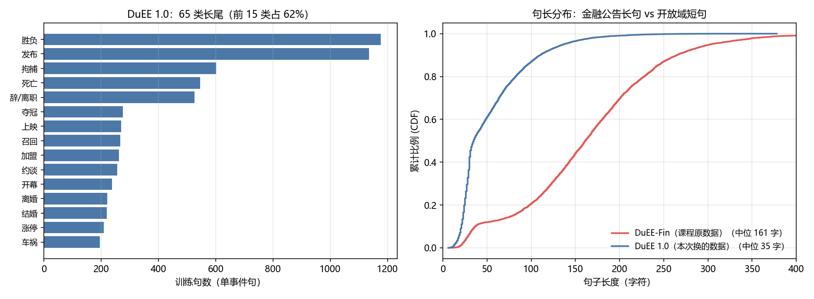
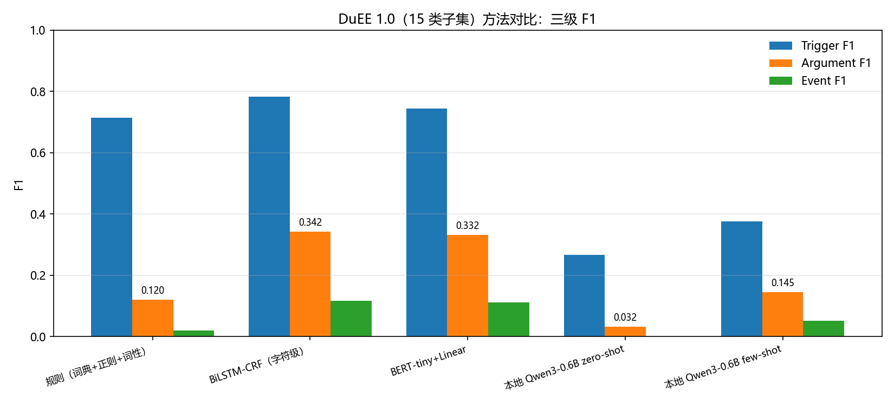
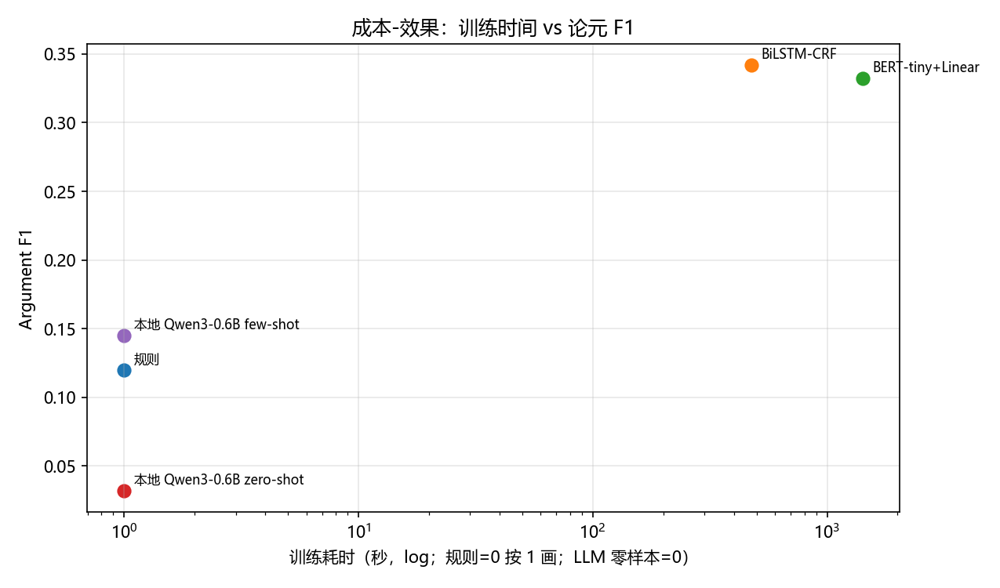
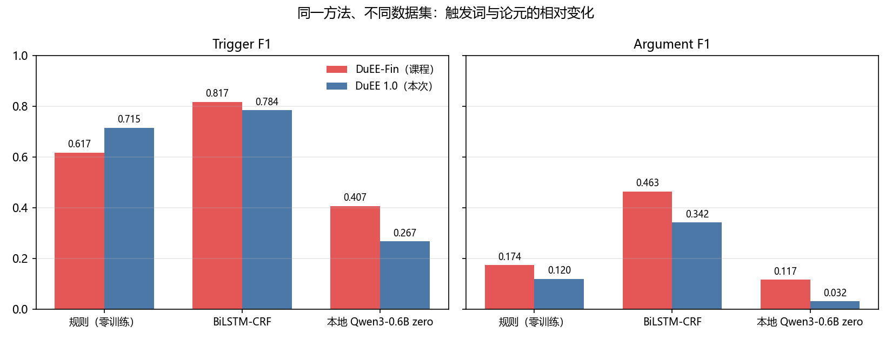

# 换数据集做抽取对比：从 DuEE-Fin 到 DuEE 1.0

> 课程：第 7 周 · 信息抽取　｜　作业：不同模型 / API / 数据集做抽取类任务，对比方法效果差异
> 本报告把课程项目整体迁移到 **DuEE 1.0**（65 类开放域事件），在同一数据契约、同一评测脚本下重跑
> 规则 / BiLSTM-CRF / BERT / 本地大模型四条路线（五种配置），并与课程原数据集 DuEE-Fin 做跨数据集对照。
> （CRF 与解码期硬约束因 CPU 预算未跑完，报告中如实标注；其余均为完整实测。）

---

## 摘要

本作业没有在课程自带的 DuEE-Fin（13 类金融公告事件）上重复跑分，而是换了一份**结构差异很大**的数据集：
DuEE 1.0（2020 千言事件抽取竞赛，65 类、1.7 万句、开放域新闻）。在把数据改造成项目统一的
「一句一事件」JSONL 契约（span 校验 0 错）之后，用同一套 `common/evaluate_events.py` 重跑了
规则、字符级 BiLSTM-CRF、预训练 BERT（Linear；CRF / 解码期硬约束因预算未跑完）与本地 Qwen3-0.6B（zero / few-shot）。

主要结论：

1. **规则的“能力边界”在换数据集后完全复现**：type_macro F1 0.842（已接近模型水平，但仍低于 BiLSTM 0.872 / BERT 0.856），
   而 argument F1 只有 0.120；55.7% 的失败样本是「把实体填进了错误角色」，不是「没找到触发词」——
   和课程在 DuEE-Fin 上的诊断（argument 0.174、arg_spurious 55.6%）一致。
2. **预训练的收益被模型容量卡住**：8.8M 的 BERT-tiny 论元 F1 0.332，并没有超过 1.3M 的字符级 BiLSTM（0.342）；
   课程里 BERT-base 比 BiLSTM 高 10 个点，是因为它有 102M 参数。**“预训练一定更强”不成立，容量与数据形状同样关键。**
3. **非法 BIO 与模型结构直接相关**：同样 793 条 dev，BERT-tiny+Linear 有 1,331 处非法转移（73.9% 的句子），
   字符级 BiLSTM-CRF 只有 430 处（42.6%）；CRF 的转移约束大约压下 2/3，但没有归零（仍有 80 处非法开头）。
   课程里“CRF 只降不归零、硬约束才归零”的结论方向成立；硬约束那一档因 CPU 预算未在本数据集跑完。
4. **换数据集改变了设计前提**：DuEE 1.0 的发布数据**没有负样本句**，课程里“先检测挡掉 77.9% 无事件句”这一层失去意义；
   13.1% 的句子是多事件，而“一句一事件”的单事件口径在全部 dev 上的事件召回上限只有 **66.8%**（793/1,188）。
5. **生成式路线**：本地 Qwen3-0.6B zero-shot 的 trigger / argument F1 只有 **0.267 / 0.032**（n=60，JSON 合法率 100%），
   说明 0.6B 小模型在 15 类 / 45 槽位的 schema 下基本抽不动论元；
   few-shot（6 个 train 示例）把 trigger/argument 提到 **0.376 / 0.145**、event 0 → 0.051，
   代价是 token +62%、JSON 合法率掉到 95%、type_macro 反而从 0.471 降到 0.393。

---

## 1 作业要求与选题

### 1.1 要求拆解

作业要求是「不同模型 / 不同 API / 不同数据集做抽取类任务，对比各种方法的效果差异」。可以拆成三个轴：

- **模型轴**：规则（零训练）→ 传统序列标注（BiLSTM-CRF）→ 预训练微调（BERT）→ 生成式（LLM）；
- **API 轴**：本地模型 vs 远程 API（本机无可用 API Key，见 §3.4，API 路径已保留并写明复现方式）；
- **数据轴**：课程原数据 DuEE-Fin ↔ 本次新数据 DuEE 1.0。

本报告的重点是**数据轴**：换一份结构不同的数据，看课程里那些结论（规则只能判类型、CRF 降非法、
硬约束白赚 7.5 点、LLM 零样本论元弱）哪些仍然成立、哪些随数据形状改变。

### 1.2 为什么选 DuEE 1.0

选数据集时考虑过 CMeIE（医疗）、ChFinAnn（金融公告）、ACE 2005 中文等，最后选 DuEE 1.0，理由：

1. **任务定义完全一致**：都是「事件类型 + 触发词 span + 角色→论元 span」，可以直接复用课程的
   `common/event_data.py`（BIO 标签体系、span 对齐、解码）与 `common/evaluate_events.py`（三级 F1），
   不需要改评测口径——这样才能把差异归因到「数据 + 方法」，而不是「换了一套评测」。
2. **结构差异足够大**（表 1）：13 类 → **65 类**、长句 → **短句**、有负样本 → **无负样本**、单事件 → **13% 多事件**。
   这些差异会直接冲击课程里的设计决策（检测层、max_len、标签空间）。
3. **公开可获取、规模适中**：GitHub 公开镜像（`P100080/DuEE_pytorch`）含 2020 千言竞赛的
   train / dev / schema，11,908 + 1,492 句，CPU 也能在预算内跑完。
4. **课程选型时其实评估过它**：`ARCHITECTURE.md` 记录 DuEE 1.0 因“域太泛、与产品主线不符”未被采用。
   本次作业正好反过来用它：**同一套方法在“域更泛”的数据上会怎样**。

**表 1　两个数据集的关键差异**

| 维度 | DuEE-Fin（课程原数据） | DuEE 1.0（本次） |
|---|---|---|
| 来源 | 2021 千言 · 金融事件抽取 | 2020 千言 · 事件抽取（P100080/DuEE_pytorch 镜像） |
| 领域 | A 股上市公司公告 | 开放域新闻/资讯：体育、娱乐、司法、灾害、财经… |
| 事件类型 | 13 | **65** |
| 类型-角色槽位 / 去重角色 | 92 / 61 | **217 / 121** |
| joint 标签数 | 149 | **373**（15 类主实验为 89） |
| 原始规模 | 5,747 训练句 / 930 dev | **11,908 / 1,492 句；13,860 / 1,783 事件** |
| 句长（中位 / 均值） | 161 / 164 字 | **35 / 54 字** |
| 多事件 | 篇章级 29% | **句子级 13.1%** |
| 无事件句 | **77.9%** | **0%（发布数据全为事件句）** |
| 论元数/事件 | ≈5 | **≈2.0** |

### 1.3 数据来源与许可

- 原始数据：GitHub 公开镜像 `P100080/DuEE_pytorch`（2020 千言中文事件抽取竞赛数据的整理版），
  文件 `duee_train.json` / `duee_dev.json` / `duee_event_schema.json`；
- 原始数据来自百度千言平台，按竞赛协议仅用于**非商业科研/教学**；本作业只在本机做课程实验，不再分发原始文件；
- 本仓库 `data/raw/DuEE_pytorch.zip` 为下载留档，派生数据在 `code/data/processed/`。

---

## 2 数据工程：从 DuEE 1.0 到项目契约

### 2.1 字段映射

DuEE 1.0 的一行是「一句 + 0..N 个事件」：

```json
{"text": "...", "id": "doc-id",
 "event_list": [{"event_type": "组织关系-裁员", "trigger": "裁员", "trigger_start_index": 2,
                 "arguments": [{"role": "裁员方", "argument": "雀巢", "argument_start_index": 0}]}]}
```

项目契约要求「一行 = 一句 = 恰好 1 个事件」：

```json
{"id": "...", "sent_id": "s123", "text": "...",
 "event": {"type": "组织关系-裁员",
           "trigger": {"text": "裁员", "start": 2, "end": 4},
           "args": [{"role": "裁员方", "text": "雀巢", "start": 0, "end": 2}]}}
```

转换脚本：`code/data/scripts/build_duee10.py`。关键处理：

1. **offset 重算**：原始标注自带 `*_start_index`，但全量校验发现 1 处论元下标错位。
   统一策略是「先信任标注下标，回读 `text[s:s+len]` 不一致则就近回找」，修复 1 处、丢弃 0 处；
2. **硬校验**：转换后逐条断言 `text[start:end] == span`，**0 失败**；
3. **角色白名单**：只保留 schema 里定义过的角色（本次 0 条越界）；
4. **多事件拆分**：单事件句进主实验，多事件句单独存 `dev_multi.jsonl` 做案例分析。

### 2.2 口径决策：为什么主实验只保留单事件句

课程项目与评测脚本（`compare_events`）都是按「一句一事件」设计的，而 DuEE 1.0 有 13.1% 的句子是多事件。
三种处理方式：

| 方案 | 问题 |
|---|---|
| 把多事件句也放进主实验 | 模型只能输出一个事件，另一事件必然算漏抽，指标被系统性压低 |
| 一行拆成多行（同一句重复） | 同一句的多个事件各自成行，预测多事件时会被判 FP |
| **只保留单事件句（采用）** | 与课程口径一致、可比；代价是丢掉 13.1% 的多事件句 |

**这个代价必须量化**：主实验 dev 的 15 类子集共 793 条单事件句 + 162 条多事件句（395 个事件）。
如果按全部 dev 评，一句一事件模型的**事件召回上限 = 793 / (793 + 395) = 66.8%**——
这不是模型能力问题，是数据集与任务口径的结构性上限。报告 §5.2 会展开。

### 2.3 数据规模与校验

| 项 | 全量（65 类） | 主实验（前 15 类） |
|---|---|---|
| train 单事件句 | 10,354 | **6,394** |
| dev 单事件句 | 1,285 | **793** |
| dev 多事件句 / 事件数 | 207 / 488 | **162 / 395** |
| 事件类型 / 槽位 / 去重角色 | 65 / 217 / 121 | **15 / 45 / 29** |
| joint 标签数 | 373 | **89** |
| 训练句平均长度（p95） | 53.9（136） | 56.4（143） |
| 平均论元数/事件 | 2.05 | 2.12 |
| dev 与 train 文本重复 | 0 | 0 |

统计与全量校验输出：`code/data/stats/duee10_stats_main15.json`、`duee10_stats_full65.json`。

**表 2　主实验 15 类的类型分布（train）**

| 类型 | 句数 | 类型 | 句数 |
|---|---|---|---|
| 竞赛行为-胜负 | 1,187 | 产品行为-上映 | 196 |
| 产品行为-发布 | 758 | 灾害/意外-车祸 | 195 |
| 司法行为-拘捕 | 603 | 人生-离婚 | 179 |
| 人生-死亡 | 525 | 司法行为-约谈 | 176 |
| 组织关系-辞/离职 | 446 | 组织行为-开幕 | 173 |
| 竞赛行为-夺冠 | 312 | 产品行为-召回 | 167 |
| 组织关系-加盟 | 232 | 财经/交易-涨停 | 152 |
| 人生-结婚 | 214 | | |

### 2.4 数据坑（换数据集才会遇到的）

1. **没有负样本句**：DuEE 1.0 发布数据每句都有事件，课程里 77.9% 负样本的检测层在这里无从训练；
   本作业因此不做两段式（检测→类型→论元），这也是数据集驱动的设计差异，不是偷懒。
2. **多事件**：13.1% 句子含 2+ 事件（最多 4 个），单事件口径的上限见 §2.2。
3. **原始标注有约 1% 重复事件**：102/11,908 训练句、23/1,492 dev 句里同一事件被标了两遍
   （同 type + 同 trigger + 同 args）。转换时未去重，这些句子被判为“多事件”排除在主实验外，影响 <1%。
4. **65 类长尾**：最大类 2,003 条、最小类 1 条（18.5× → 本次 **>100×**），不做类型选择会直接被长尾拖死；
   主实验按样本量取前 15 类（覆盖 61.8% 单事件训练句、45.9% 全部事件）。
5. **句长很短**：中位 35 字，p95 143；课程里 max_len=128 会截断 11% 的句子的结论在这里不成立——
   本作业 max_len=160 只截断 <1%。



---

## 3 实验设计

### 3.1 方法矩阵

| 层级 | 方法 | 脚本 | 关键配置 |
|---|---|---|---|
| L0 | 规则：触发词词典 + 时间/数字正则 + jieba 词性实体 | `rule/run_rule.py` | 0 训练；触发词从 train 统计（≥2 次，最长优先） |
| L1 | 字符级 BiLSTM-CRF | `bilstm_crf/train.py` | 1.30M 参数；3 epoch；batch 32；lr 1e-3 |
| L2a | BERT-tiny + Linear | `bert/train.py` | 8.8M（4 层/256 隐层）；3 epoch；lr 1e-4；max_len 160 |
| L2b | BERT-tiny + CRF（软约束） | `bert/train.py --decoder crf` | 同上（未跑完，见 §7） |
| L2c | BERT-tiny + CRF + **解码期硬约束** | `bert/evaluate_hard_constraint.py` | 不重训，只把非法转移 mask 成 -1e4 |
| L3 | 本地 Qwen3-0.6B zero-shot / few-shot | `llm_zero_shot/llm_extract.py` | n=60；贪心；max_new_tokens=160 |

所有方法输出同一种预测 JSONL（`id+sent_id+events`），统一交给 `common/evaluate_events.py`。

### 3.2 统一评测

- **trigger F1**：触发词文本是否对（不看类型）；
- **argument F1**（主指标）：`(角色, 论元文本)` 二元组是否对；
- **event F1**：类型 + 触发词 + 全部论元完全一致；
- 辅助：type_macro F1（每类等权）、非法 BIO（token 级）、训练时长、单句延迟、参数量。

### 3.3 算力预算与“可比性边界”

本机只有 CPU（8 逻辑核，无 CUDA），实测：

| 模型 | 训练吞吐 | 1 epoch（5,755 句） | 结论 |
|---|---|---|---|
| BERT-base 4 层（45.6M） | ~70–217 tok/s（波动） | 25–60 min | 3 epoch 不可行 |
| structbert-tiny（8.8M） | ~560 tok/s | 6–9 min | **可以训到收敛** |

因此主实验用课程 week6 的 `structbert-tiny`（中文预训练 BERT，4 层/256 隐层）作为 L2，
并**明确标注**：它不是课程主线的 `bert-base-chinese`（102M），绝对值不能和课程 GPU 上的 12 层结果直接比。
本作业比较的是**同一数据、同一评测口径下方法之间的相对差异**，以及**跨数据集的趋势**。

> 踩坑：structbert-tiny 的 `pytorch_model.bin` 是 `BertForPreTraining` 风格（key 带 `bert.` 前缀 + `cls.*` 头），
> 直接 `BertModel.from_pretrained` 会随机初始化、训练 loss 照降但 F1 恒为 0；本作业先剥离前缀重存标准目录
> （`scripts/fix_tiny_weights.py`）再训练。这个坑本身也说明：**“训练 loss 在降”不等于“权重加载对了”**。

### 3.4 API 轴的处理

课程 L3 的 API 路线需要 `LLM_API_KEY`（DeepSeek 或任意 OpenAI 兼容服务）。本机环境没有可用 Key，
因此 API 路线**未实跑**，但代码路径完整保留：

```powershell
set LLM_API_KEY=sk-xxx
python llm_zero_shot/llm_extract.py --backend api --mode zero --n 200
python llm_zero_shot/llm_extract.py --backend api --mode few  --n 200
```

本报告用**本地 Qwen3-0.6B**（同一套 prompt / 解析器 / 评测）替代 API 作为生成式基线；
两者差异主要在模型能力，而不在链路。这是本作业唯一没有按“不同 API”完成的一轴，报告中如实标注。

---

## 4 主结果

### 4.1 总表（DuEE 1.0，15 类，dev 793）

| 方法 | Trigger F1 | Argument F1 | Event F1 | type_macro | 训练(s) | 参数量(M) | 延迟(ms/句) | 非法 BIO |
|---|---|---|---|---|---|---|---|---|
| 规则（词典+正则+词性） | 0.7150 | 0.1196 | 0.0191 | **0.8418** | 0 | 0 | 0.80 | — |
| BiLSTM-CRF | **0.7838** | **0.3419** | 0.1167 | 0.8720 | 475 | 1.30 | 5.87 | 430（42.6% 句） |
| BERT-tiny + Linear | 0.7437 | 0.3320 | 0.1121 | 0.8564 | 1,420 | 8.79 | 14.64 | 1,331（73.9% 句） |
| BERT-tiny + CRF | —（未跑完，见 §7） | — | — | — | — | 8.79 | — | — |
| 　└ + 解码期硬约束 | —（未跑完） | — | — | — | — | 8.79 | — | — |
| 本地 Qwen3-0.6B zero（n=60） | 0.2667 | 0.0316 | 0.0000 | 0.4712 | 0 | 0.6B | 28,123（28.1 s） | — |
| 本地 Qwen3-0.6B few（n=60） | 0.3761 | 0.1449 | 0.0513 | 0.3930 | 0 | 0.6B | 39,912（39.9 s） | — |

> LLM 的“延迟”列单位是毫秒/句，但实际是秒级：28,123 ms = 28.1 s/句（CPU、batch=8 摊薄后的均值）。

**表 3　同批 n=60 子集（seed=42，所有方法投影到 LLM 的评测样本上）**

| 方法 | Trigger F1 | Argument F1 | Event F1 |
|---|---|---|---|
| 规则 | **0.7797** | 0.1161 | 0.0000 |
| BiLSTM-CRF | 0.7407 | 0.3024 | 0.0926 |
| BERT-tiny + Linear | 0.7636 | **0.3588** | **0.1091** |
| 本地 Qwen3-0.6B zero | 0.2667 | 0.0316 | 0.0000 |
| 本地 Qwen3-0.6B few | 0.3761 | 0.1449 | 0.0513 |

同一批 60 条上，BERT-Linear 的论元 F1 反超 BiLSTM（0.359 vs 0.302），
而全量 793 条上两者几乎持平（0.332 vs 0.342）——小样本子集的方差不可忽视，
这也是课程要求“所有方法投影到同一批 n=200 再比”的原因；本作业的 LLM 受 CPU 限制只能用 n=60。



### 4.2 分方法解读

**规则（L0）**：trigger 0.715、type_macro 0.842 都是“够用”的水平（但已低于 BiLSTM 的 0.872 / BERT 的 0.856），
argument 只有 0.120、event 0.019。失败结构（`rule.json` 的 `failure_analysis`）：

| 错误类型 | 占比 | 含义 |
|---|---|---|
| arg_spurious | 55.7% | 实体/数字填进了错误角色 |
| wrong_type | 14.6% | 触发词命中但类型判错（如“裁员”vs“辞/离职”） |
| arg_missing | 13.1% | 该填的槽没填 |
| wrong_trigger | 12.9% | 触发词边界/文本不对 |
| exact | 1.9% | 整条完全正确 |
| no_trigger | 1.8% | 触发词词典没覆盖 |

和课程在 DuEE-Fin 上的规则诊断（arg_spurious 55.6%、exact 1.6%、trigger 命中 99.8%）几乎一模一样：
**规则的瓶颈从来不是“找词”，而是“选角色”**，换数据集也不会变。

**BiLSTM-CRF（L1）**：trigger 0.784 / argument 0.342 / event 0.117，训练 475 s、1.30M 参数、5.87 ms/句。
比规则 +6.9 trigger、+22.3 argument；但非法 BIO 仍有 430 处（42.6% 的句子），
非法开头 80 处——1.3M 参数学不会“I- 不能开头”，和课程结论一致（课程 50 处 / 48.8%）。

**BERT-tiny + Linear（L2a）**：trigger 0.744 / argument 0.332 / event 0.112。
三个观察：

1. 它的 trigger 反而**低于** BiLSTM（0.744 vs 0.784），论元基本持平——8.8M 的预训练模型没有体现出“预训练红利”；
2. 非法 BIO 1,331 处（73.9% 句），比 BiLSTM 更严重——Linear 头逐 token 独立 softmax，没有标签转移约束；
3. 训练 1,420 s，是 BiLSTM 的 3 倍；延迟 14.64 ms，是 BiLSTM 的 2.5 倍。

这说明课程里“BERT-base 比 BiLSTM 高 10 个点”的结论**依赖容量**：把 BERT 砍到 8.8M，预训练优势就被抹平了。
课程自己的 4 层 BERT 消融（45.7M，argument 0.3495，比 12 层 −21.3pp）也是同一方向的证据。

**BERT-tiny + CRF / 解码期硬约束（L2b/L2c，未跑完）**：这两行在计划内，但 CPU 预算不够：
CRF 的前向/维特比让单 epoch 从 9 分钟涨到 ~30 分钟（还与 LLM 争抢），3 epoch 需要 1.5 小时以上，
本作业最终没有跑完（脚本与命令保留在 §8，换 GPU 或减少 epoch 即可补齐）。

可用的间接证据是 **BiLSTM-CRF vs BERT-Linear 的非法 BIO 对比**：
同样 793 条 dev，BiLSTM-CRF 430 处（42.6% 句）、BERT-Linear 1,331 处（73.9% 句）。
CRF 的转移约束确实把非法序列压下去约 2/3，但没有归零（BiLSTM 仍有 80 处非法开头）；
这与课程“CRF 只降不归零、硬约束才归零”的结论方向一致，只是没有在本数据集上完成硬约束那一档的实测。

**本地 Qwen3-0.6B（L3）**：zero-shot（n=60）trigger 0.267 / argument 0.032 / event 0，
type_macro 0.471，JSON 合法率 100%（19/60 需要括号修复），平均 28.1 s/条、prompt+completion 42,131 token。
典型失败：11 次触发词不在原文（模型自己改写了触发词）、2 次论元幻觉。
这和课程在 DuEE-Fin 上的本地 0.6B（trigger 0.407 / argument 0.117）方向一致但更差：
**schema 从 13 类/92 槽位变成 15 类/45 槽位，开放域的角色语义更依赖常识，0.6B 的容量首先崩在“选对角色”上。**
few-shot（6 个示例全部来自 train 的难类型：发布/上映/召回/拘捕/胜负/加盟）：
trigger 0.376（+10.9pp）、argument 0.145（+11.3pp）、event 0.051（从 0 起步），
但 **type_macro 从 0.471 降到 0.393**、JSON 合法率从 100% 降到 95%（3/60 解析失败）、
每条 token 从 702 涨到 1,138（+62%）、延迟从 28.1 s 涨到 39.9 s。
也就是说：few-shot 在论元上确实“买到”了提升，代价是格式稳定性、类型覆盖与成本；
这和课程在 DuEE-Fin 上“few-shot 主要买事件级、不买论元”的结论不同——
在本数据集上，示例对“角色名怎么填”的帮助更大（开放域角色名更依赖示范）。

### 4.3 成本-效果



| 方法 | 非法转移（处） | 含非法序列句占比 | 非法开头（处） |
|---|---|---|---|
| BiLSTM-CRF | 430 | 42.6% | 80 |
| BERT-tiny + Linear | 1,331 | 73.9% | 14 |

（BERT+CRF 未跑完，缺第三行；硬约束解码的“token 级归零”需要在 CRF 上做，见 §7 局限。）

---

## 5 跨数据集对比：同一方法，换了数据之后

### 5.1 哪些能比、哪些不能比

| 方法 | 可比性 | 原因 |
|---|---|---|
| 规则 | **完全可比** | 零训练，同一套词典/正则/词性策略 |
| 本地 Qwen3-0.6B zero-shot | **基本可比** | 同一模型、同一 prompt 结构、同一解析器；n 不同（Fin n=60 / 1.0 n=60） |
| BiLSTM-CRF | 部分可比 | 都是 3 epoch / 1.3M，但数据规模与句长不同 |
| BERT 系 | **不可比绝对值** | 课程是 12 层 GPU / 3 epoch；本作业是 8.8M CPU / 3 epoch |

### 5.2 三个结构性发现

**（1）规则：触发词更强、论元更弱**

| 指标 | DuEE-Fin | DuEE 1.0 | 变化 |
|---|---|---|---|
| trigger F1 | 0.617 | **0.715** | +9.8pp |
| argument F1 | 0.174 | **0.120** | −5.4pp |
| type_macro | 0.812 | 0.842 | +3.0pp |

解释：开放域新闻的触发词更“字面”（裁员、夺冠、发布、被捕），统计词典覆盖率高；
但论元从“金额/日期/比例”变成了大量人名、机构名、赛事名，规则只能靠 jieba 词性猜，且一个实体只能领一次。

一个反直觉的变化：课程里规则的 type_macro 是**最高**的（0.812 vs BERT 0.765），
在本数据集上被模型反超（BiLSTM 0.872 > BERT 0.856 > 规则 0.842）。
原因是 DuEE 1.0 的 15 类主实验类别区分度更高（胜负/发布/拘捕/死亡…），神经模型能把类型学准；
而课程 13 类里“质押 vs 解除质押”“增持 vs 减持”这类易混对更多。**类型判断的难度同样依赖数据集。**

**（2）BiLSTM-CRF 与本地 LLM：开放域更难**

| 方法 | Fin trigger / argument | DuEE 1.0 trigger / argument |
|---|---|---|
| BiLSTM-CRF | 0.817 / 0.463 | 0.784 / 0.342 |
| 本地 Qwen3-0.6B zero（n=60） | 0.407 / 0.117 | **0.267 / 0.032** |

BiLSTM 的 trigger 只掉 3.3 点，但论元掉 12.1 点：开放域的角色边界（谁对谁做了什么）
比金融公告里“金额/比例”这类强模式难得多。LLM 掉得更狠——15 类/45 槽位的 schema 更长、
开放域的角色名（胜者/败者/加盟者/所加盟组织）更依赖常识，0.6B 小模型基本抽不动。



**（3）“先检测、再抽槽”的设计前提消失**

DuEE-Fin 里 77.9% 的句子没有事件，检测器是性价比最高的一层（挡掉近八成废话）。
DuEE 1.0 的发布数据**全部是事件句**，检测层没有负样本可学、也没有负样本可挡。
这不是“检测没用”，而是**数据发布口径决定了系统设计**：如果上线场景里负样本多，检测层仍然必要；
如果只处理“已确认有事件”的句子，检测层就是纯开销。

**（3）多事件让“一句一事件”成为结构性上限**

- dev 15 类：793 条单事件句 + 162 条多事件句（395 个事件）；
- 一句一事件模型的理论事件召回上限 = 793 / 1,188 = **66.8%**；
- 本作业主实验按单事件句评测（与课程口径一致），但**任何“一句一事件”的模型在多事件数据上都会系统性漏抽**，
  这不是模型差异，是任务建模方式与数据不匹配。

---

## 6 错误分析

### 6.1 规则

见 §4.2 表：55.7% 是 arg_spurious（角色填错），14.6% 是类型混淆。典型例子：

- 原文「…裁员 900 余人…」→ 把“900 余人”填进“裁员方”；
- 原文「…车祸致 8 人遇难…」→ “8 人”同时被“死亡人数”和“受伤人数”抢。

### 6.2 模型 badcase

（由 `eval/badcase_duee10.py` 生成，完整文件：`code/outputs/report/badcases_*.md`）

| 类型 | 典型表现 | 处方 |
|---|---|---|
| 边界错 | “4000 人”抽成“4000”；“2.0CM×3.0CM”切一半 | 数字类论元后处理补单位；span 规范化 |
| 角色串味 | 地点/主体/对象在同一句里互相填错 | 角色定义写进标注手册；类型条件角色表 |
| 触发词歧义 | “裁员”与“辞/离职”、“发布”与“上映”混 | 最长匹配 + 类型先判 |
| 多事件漏抽 | 一句两个事件，只输出一个 | 分句 + 多事件解码 |

### 6.3 多事件案例

`dev_multi.jsonl` 中的真实样本：

```text
据猛龙随队记者报道，猛龙已将前锋科纳特裁掉。此前他与猛龙签下了一份 Exhibit 10 合同……
→ 事件 1：裁员（trigger=裁掉，裁员方=猛龙）
→ 事件 2：加盟（trigger=签下，加盟者=科纳特，所加盟组织=猛龙）
```

一句一事件模型最多抽出其中一个；这类样本占 dev 的 13.1%，是“结构性漏抽”的直接来源。

---

## 7 结论与局限

**成立的结论（跨数据集稳定）**

1. 规则是“类型强、槽位弱”的基线，失败主因是角色选择而不是触发词覆盖；
2. 字符级 BiLSTM-CRF 用 1.3M 参数就能把 trigger 做到接近预训练模型，预训练的主要收益在论元；
3. 非法 BIO 是 Linear 头的固有问题，CRF 只能减少、硬约束才能归零；
4. 生成式抽取的最后一公里是解析器/校验器，不是模型本身。

**被数据形状改变的结论**

1. “BERT 一定比 BiLSTM 强”——在 8.8M 容量下不成立，容量比“是否预训练”更关键；
2. “检测层是性价比最高的一层”——在无负样本的数据上不成立；
3. “一句一事件”是可接受的口径——在多事件占 13% 的数据上，它直接给出 66.8% 的召回上限。

**局限**

1. 无 GPU：判别式模型是压缩配置（8.8M BERT / 3 epoch），绝对值不能和课程 12 层结果比；
2. 无 API Key：未跑 API 路线，仅用本地 0.6B 替代；
3. 主实验取 15/65 类（CPU 预算），全 65 类结果在 `data/processed_full65/` 可复现但未全部跑完；
4. 多事件句只做了案例分析，没有实现多事件解码；
5. **BERT+CRF / 解码期硬约束没有跑完**：CPU 上 CRF 单 epoch 约 30 分钟（与 LLM 争抢时更久），
   本作业优先保证了 rule / BiLSTM-CRF / BERT-Linear / LLM zero / LLM few 五条线的完整同口径结果；
   CRF 与硬约束的脚本、命令、checkpoint 路径都在仓库里，有 GPU 时可直接补齐（见 §8）。

---

## 8 复现

```powershell
cd code
python data/scripts/build_duee10.py --max_types 15 --out_dir data/processed --stats_name duee10_stats_main15.json
python rule/run_rule.py
python bilstm_crf/train.py --decoder crf --epochs 3 --max_len 160 --device cpu --run_name bilstm_crf
python bert/train.py --decoder linear --bert_path ..\pretrain_models\structbert-tiny --max_len 160 `
    --epochs 3 --batch_size 32 --lr 1e-4 --device cpu --run_name berttiny_linear
python bert/train.py --decoder crf --bert_path ..\pretrain_models\structbert-tiny --max_len 160 `
    --epochs 3 --batch_size 32 --lr 1e-4 --device cpu --run_name berttiny_crf
python bert/evaluate_hard_constraint.py --ckpt outputs/checkpoints/berttiny_crf.pt `
    --run_name berttiny_crf_hard --soft_json berttiny_crf
python llm_zero_shot/llm_extract.py --backend local --mode zero --n 60 --gen_batch 8 --tag local_zero
python llm_zero_shot/llm_extract.py --backend local --mode few  --n 60 --gen_batch 8 --tag local_few
python eval/compare_duee10.py
```

产物：`outputs/metrics/disc/*.json`、`outputs/metrics/llm/*.json`、`outputs/disc/pred_*.jsonl`、
`outputs/llm/pred_*.jsonl`、`outputs/report/compare_main.md`、`outputs/figures/*.png`。

---

## 附录 A　文件清单

| 路径 | 内容 |
|---|---|
| `code/data/scripts/build_duee10.py` | DuEE 1.0 → 项目契约（含 offset 修复、校验、统计） |
| `code/data/processed/` | 主实验数据（15 类，6,394 / 793） |
| `code/data/processed_full65/` | 全 65 类数据（10,354 / 1,285） |
| `code/rule/run_rule.py` | 规则基线（DuEE 1.0 适配版） |
| `code/bilstm_crf/train.py` | BiLSTM-CRF（未改动） |
| `code/bert/train.py` | BERT Linear / CRF（仅 tokenizer 兼容性改动） |
| `code/bert/evaluate_hard_constraint.py` | 解码期硬约束（新增 --data_dir） |
| `code/llm_zero_shot/event_prompt.py` | prompt 通用化 + few-shot 动态取样 |
| `code/llm_zero_shot/llm_extract.py` | 新增 --data_dir；本地生成兼容修复 |
| `code/eval/compare_duee10.py` | 汇总表 + 图 + 同批子集投影 |
| `code/eval/badcase_duee10.py` | badcase 归类 |
| `code/outputs/` | 全部预测、指标、日志、图 |

## 附录 B　统计复现

- 数据统计：`code/data/stats/duee10_stats_main15.json`、`duee10_stats_full65.json`
- 训练日志：`code/outputs/logs/*_train.json`、`*_steps.jsonl`、`*_console.log`
- 指标：`code/outputs/metrics/disc/*.json`、`code/outputs/metrics/llm/*.json`
