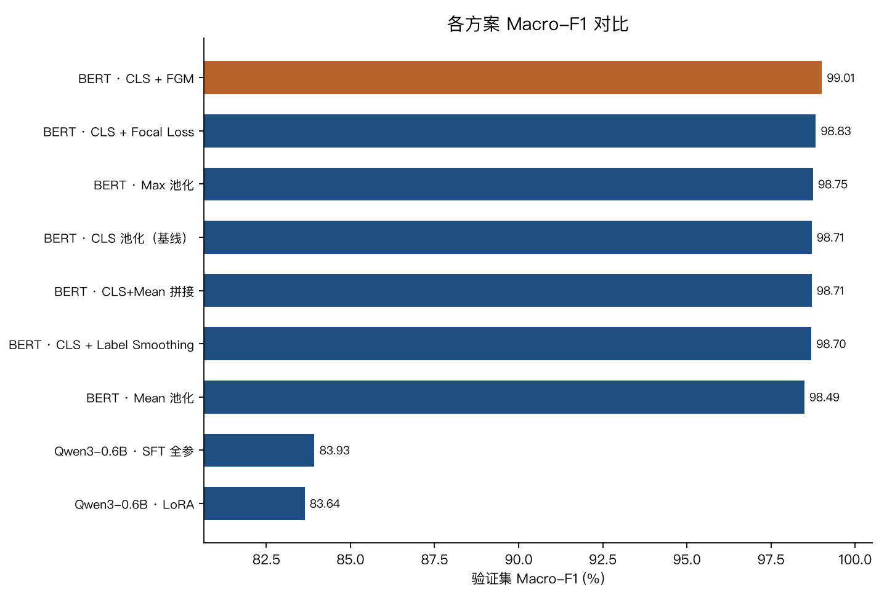

# 文本分类方案对比报告

> 数据：商品名 → 10 品类（train 14,397 / val 1,600 / test 4,003）
> 硬件：RTX 4090（24 GB）
> 指标：验证集 **Macro-F1**（各类等权）

## 一、总榜

| 方案 | Macro-F1 | Accuracy | 训练耗时(s) | 备注 |
|---|---|---|---|---|
| **BERT · CLS + FGM** | **0.9901** | 0.9931 | 113 | 最佳 |
| BERT · CLS + Focal Loss | 0.9883 | 0.9919 | 70 | |
| BERT · Max 池化 | 0.9875 | 0.9919 | 68 | |
| BERT · CLS 池化（基线） | 0.9871 | 0.9912 | 72 | |
| BERT · CLS+Mean 拼接 | 0.9871 | 0.9919 | 69 | |
| BERT · CLS + Label Smoothing | 0.9870 | 0.9912 | 71 | 无效果 |
| BERT · Mean 池化 | 0.9849 | 0.9906 | 71 | 最差 |
| Qwen3-0.6B · SFT 全参 | 0.8393 | 0.8781 | 707 | |
| Qwen3-0.6B · LoRA | 0.8364 | 0.8762 | 340 | 0.76% 参数 |

**差距：BERT 最佳（0.9901）比 LLM 最佳（0.8393）高 15.1 个点。**
换算成错误数：BERT 约 16/1600 条判错，LLM 约 258/1600 条。

## 二、多随机种子验证（关键）

单次运行的 0.1~0.3 个点差异**可能只是噪声**（1600 条验证集上，0.1 点 = 1.6 条样本）。
所以对三个关键配置各跑了 3 个种子：

| 配置 | seed 42 | seed 7 | seed 2024 | 均值 | 标准差 |
|---|---|---|---|---|---|
| CLS 基线 | 0.9871 | 0.9875 | 0.9844 | **0.9863** | 0.0017 |
| Max 池化 | 0.9875 | 0.9848 | 0.9845 | **0.9856** | 0.0017 |
| CLS + FGM | 0.9901 | 0.9895 | 0.9896 | **0.9897** | 0.0003 |

**结论：**

| 对比 | 差值 | 判断 |
|---|---|---|
| FGM − CLS | **+0.0034** | ✅ **真实提升**（3 个种子全部优于基线，最差 FGM 0.9895 > 最好基线 0.9875） |
| Max − CLS | −0.0007 | ❌ 无差异（远小于标准差 0.0017） |

FGM 不仅均值更高，**标准差还小了 5 倍**（0.0003 vs 0.0017）——说明它让训练更稳定。

## 三、各项分析

### 3.1 池化方式：在饱和任务上几乎无差别

| 池化 | Macro-F1 | 相对基线 |
|---|---|---|
| CLS | 0.9871 | — |
| Max | 0.9875 | +0.0004 |
| CLS+Mean | 0.9871 | 0 |
| Mean | 0.9849 | −0.0022 |

四种池化的差距最大只有 0.22 个点，**在噪声范围内**（种子标准差 0.17）。

原因：这个任务已经接近饱和（98.7%）。当模型几乎全对时，
「怎么把 BERT 的隐状态压成一个向量」的差别就被淹没了。

> 池化的价值通常体现在**难任务**上（长文本、细粒度情感、检索）。
> 在简单分类任务上换池化，收益基本为零。

### 3.2 FGM 是唯一稳定有效的技巧

- 均值 +0.34 个点
- 3/3 种子全部优于基线
- 代价：训练时间 **+57%**（113s vs 72s）

它为什么有效：FGM 在 embedding 上加扰动，迫使模型不依赖单个词的精确表示。
商品名里的品牌词、规格词（`500ml`、`180g`）是典型的「容易过拟合的局部特征」，
FGM 正好削弱这类捷径。

### 3.3 Focal Loss 轻微正向（+0.12）

单次运行 0.9883，在种子噪声范围内（±0.17），**不能算显著**。

任务本身不均衡程度只有 4.9:1，且各类都学到了（最低类 F1 也有 0.95+），
Focal 想解决的「难样本学不会」问题在这里不存在。

### 3.4 Label Smoothing 完全无效（−0.01）

0.9870 vs 基线 0.9871，完全一样。

原因同上：任务已饱和，模型本来就没有过度自信的空间；
LS 的作用是抑制过拟合，而这里没有明显过拟合（3 个 epoch 内 val 一直在涨）。

### 3.5 LoRA 与全参 SFT 几乎打平

| | 可训练参数 | Macro-F1 | 耗时 |
|---|---|---|---|
| 全参 SFT | 596 M (100%) | 0.8393 | 707 s |
| LoRA (r=16) | **4.6 M (0.76%)** | 0.8364 | 340 s |

**用 0.76% 的参数、一半的时间，只损失 0.29 个点。**

这是 LoRA 的典型表现：在数据量不大（1.4 万条）、任务简单的场景下，
低秩更新足以覆盖需要学习的增量。

## 四、为什么 LLM 输给 BERT 15 个点

| 原因 | 说明 |
|---|---|
| **预训练目标不匹配** | BERT 用 MLM，天然学到词的语义表示；Qwen3 是自回归，擅长续写而非判别 |
| **输出空间被压缩** | LLM 用「答案首 token 的 logits」做 10 分类，等于只用了模型能力的一小部分 |
| **模型规模** | 0.6B 的判别能力远不如 110M 的 BERT 在它擅长的任务上 |
| **数据量** | 1.4 万条足够微调 BERT，但不足以重塑 0.6B LLM 的生成行为 |
| **任务性质** | 短文本、关键词特征强——这正是 BERT 的舒适区 |

> 换个任务（需要世界知识、需要推理），LLM 的优势就会显现。
> 这个数据集恰好是「关键词匹配」，BERT 的最优场景。

## 五、结论

1. **最优方案：BERT + CLS 池化 + FGM，Macro-F1 = 0.9897（3 种子均值）**
2. **池化方式在这个任务上无关紧要**，别花时间调
3. **FGM 是唯一值得开的技巧**，+0.34 点、训练慢 57%
4. **LoRA 性价比极高**，0.76% 参数换 99.6% 的效果
5. **LLM 在此任务上不划算**，除非任务需要推理或世界知识

## 六、局限

- 验证集只有 1,600 条，0.1 个点 = 1.6 条样本，**小差异不可靠**
- 任务接近饱和（98.7%），天花板可能就在 99% 附近——剩下的是果汁两类的标注歧义
- LLM 只跑了 1~2 个 epoch，未做超参搜索；加大数据量或换 prompt 可能缩小差距

---

*数据与代码：`bert/`、`llm/`、`report.py`*
