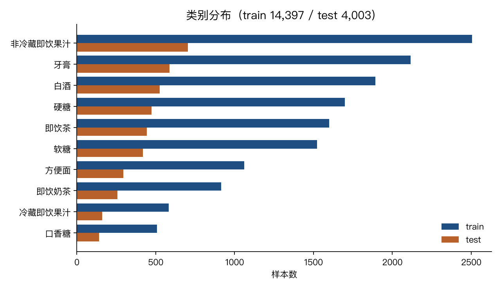
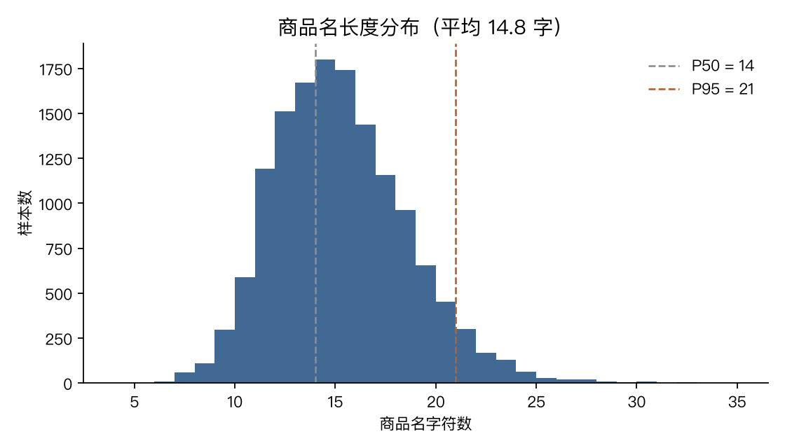
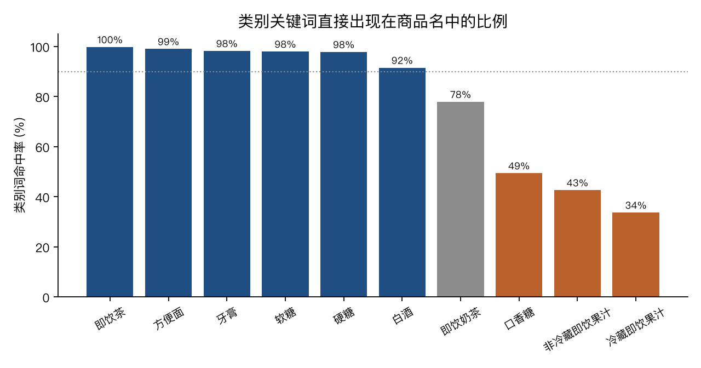

# 商品分类数据集 · 数据总览报告

> 数据：`product-classification-hiring-demo`（ModelScope，CC-BY-NC-SA-4.0）
> 任务：商品名 → 10 个品类
> 由 `data_overview.py --report` 自动生成

## 一、基本信息

| 项 | 值 |
|---|---|
| 原始训练集 / 测试集 | **15,997 / 4,003** |
| 划分后 train / val / test | 14,397 / 1,600 / 4,003 |
| 字段 | `product_name`、`category` |
| 类别数 | **10** |
| 不均衡比 | **4.9 : 1**（非冷藏即饮果汁 2504 vs 口香糖 508） |
| 商品名平均长度 | **14.8 字**（P50 14 / P95 21 / max 34） |

## 二、类别分布



| 类别 | train | val | test |
|---|---|---|---|
| 非冷藏即饮果汁 | 2504 | 278 | 704 |
| 牙膏 | 2115 | 235 | 588 |
| 白酒 | 1893 | 210 | 526 |
| 硬糖 | 1698 | 189 | 472 |
| 即饮茶 | 1599 | 178 | 444 |
| 软糖 | 1522 | 169 | 418 |
| 方便面 | 1062 | 118 | 294 |
| 即饮奶茶 | 915 | 102 | 256 |
| 冷藏即饮果汁 | 581 | 65 | 160 |
| 口香糖 | 508 | 56 | 141 |

不均衡 **4.9:1**，属温和区间（对比 TNEWS 的 23:1），
划分后 val 的比例与 train 一致，说明分层切分生效。

## 三、文本长度



商品名极短，**96% 在 21 字以内**：

- `max_len = 32` 覆盖全部样本，截断损失可忽略
- 序列短，训练与推理都快

## 四、关键词泄漏



| 类别 | 类别词出现在商品名中的比例 |
|---|---|
| 即饮茶 | 99.8% |
| 方便面 | 99.1% |
| 牙膏 | 98.3% |
| 软糖 | 98.0% |
| 硬糖 | 97.9% |
| 白酒 | 91.6% |
| 即饮奶茶 | 78.0% |
| 口香糖 | 49.5% |
| 非冷藏即饮果汁 | 42.7% |
| 冷藏即饮果汁 | 33.7% |

**这组数字决定了下限和上限：**

- 前 6 类（茶、面、牙膏、糖、酒）命中率 91%~99.8%，**一条关键词规则就能拿 95%+**
- 果汁两类只有 42.7% / 33.7%，
  商品名通常不写「冷藏/非冷藏」，这是真正的难点

## 五、数据质量

| 检查项 | 结果 |
|---|---|
| 训练集重复商品名 | 232 条 |
| 训练/测试商品名重叠 | **85 条**（占 test 2.1%） |
| 同名不同类别 | **1 条** |

唯一冲突：

```
令德堂冷榨芒果汁1.5L → ['冷藏即饮果汁', '非冷藏即饮果汁']
```

「冷藏」与「非冷藏」是储存属性，同一商品名可归两类，属标注歧义。

测试集有 85 条商品名与训练集完全相同（2.1%），
评估时这部分等于送分，**真实泛化能力会略低于报告数字**。

## 六、难点分析

真正难的只有「果汁」这一族：

```
冷藏即饮果汁:   怡亿盛园冰杨梅汁370ml
非冷藏即饮果汁: 佳纯杨枝甘露果汁480ml
```

两类文字特征几乎相同，区别在是否需要冷链——该信息**大概率不在商品名里**，
构成精度的天然上限。

## 七、建模建议

| 项 | 建议 | 依据 |
|---|---|---|
| `max_len` | **32** | P95 = 21，max = 34 |
| 类别加权 | **暂不需要** | 不均衡仅 4.9:1 |
| 基线 | 关键词规则 | 前 6 类命中率 > 91% |
| 主模型 | BERT-base 微调 | 短文本分类标准方案 |
| 评估 | macro-F1 + 混淆矩阵 | 关注果汁两类互错 |

---

*由 `data_overview.py --report` 自动生成*
