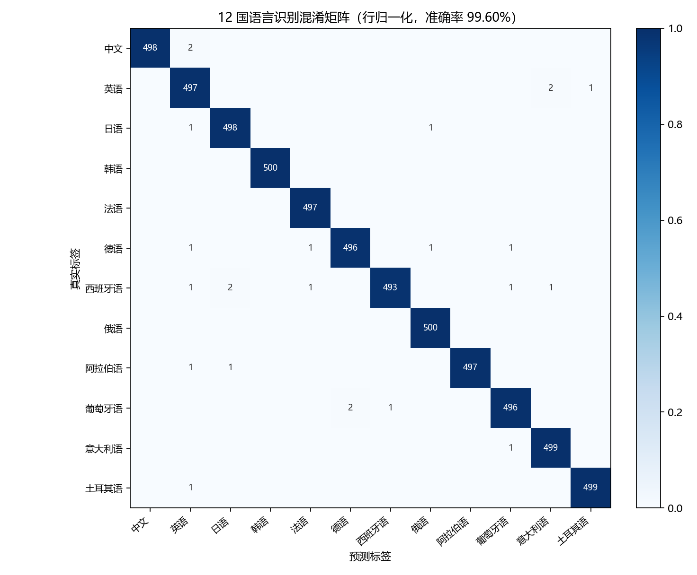
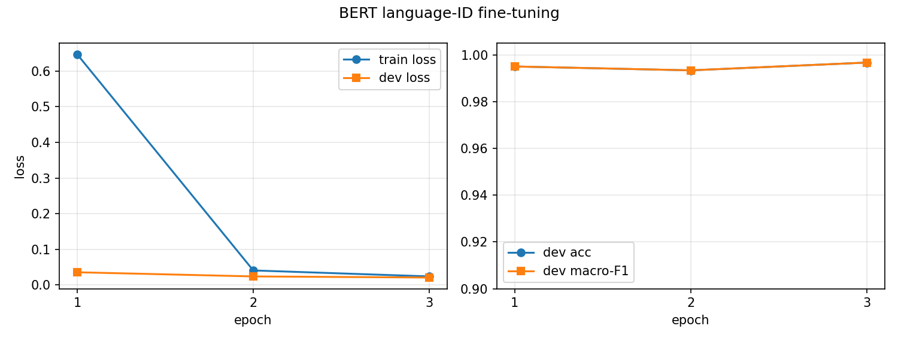

# 基于 BERT 的 12 国语言识别

> 第四周「语言模型」作业 —— 用 Transformer（BERT）预训练模型完成 12 种国家语言的文本识别（Language Identification）。
> 测试集准确率 **99.60%**，宏平均 F1 **99.60%**，误判 24 / 5994 条。

---

## 一、任务

输入一段任意文本，判断它属于下面 12 种语言中的哪一种：

| 中文 | 英语 | 日语 | 韩语 | 法语 | 德语 |
|---|---|---|---|---|---|
| 西班牙语 | 俄语 | 阿拉伯语 | 葡萄牙语 | 意大利语 | 土耳其语 |

本质是**文本分类**：BERT 编码器输出 `[CLS]` 向量 → 接一层全连接（12 类）→ softmax。
模型用 `bert-base-multilingual-cased`（mBERT，104 种语言预训练，词表 11.9 万），
在 12 语种标注数据上做**有监督微调**。

## 二、结果

| 指标 | 数值 |
|---|---|
| 测试集样本数 | 5 994（每种语言约 500 条） |
| Accuracy | **0.9960** |
| Macro-F1 | **0.9960** |
| Weighted-F1 | 0.9960 |
| 测试集 Loss | 0.0233 |
| 错分样本 | 24 条 |
| 训练耗时 | 3.7 分钟（RTX 3060，3 epoch，混合精度） |

每种语言的表现（测试集）：

| 语言 | Precision | Recall | F1 | 样本数 |
|---|---|---|---|---|
| 中文 | 1.0000 | 0.9960 | 0.9980 | 500 |
| 英语 | 0.9861 | 0.9940 | 0.9900 | 500 |
| 日语 | 0.9940 | 0.9960 | 0.9950 | 500 |
| 韩语 | 1.0000 | 1.0000 | 1.0000 | 500 |
| 法语 | 0.9960 | 1.0000 | 0.9980 | 497 |
| 德语 | 0.9960 | 0.9920 | 0.9940 | 500 |
| 西班牙语 | 0.9980 | 0.9880 | 0.9930 | 499 |
| 俄语 | 0.9960 | 1.0000 | 0.9980 | 500 |
| 阿拉伯语 | 1.0000 | 0.9960 | 0.9980 | 499 |
| 葡萄牙语 | 0.9940 | 0.9940 | 0.9940 | 499 |
| 意大利语 | 0.9940 | 0.9980 | 0.9960 | 500 |
| 土耳其语 | 0.9980 | 0.9980 | 0.9980 | 500 |



训练过程：

| Epoch | train_loss | dev_loss | dev_acc | dev_macro_F1 |
|---|---|---|---|---|
| 1 | 0.6473 | 0.0356 | 0.9950 | 0.9950 |
| 2 | 0.0407 | 0.0239 | 0.9933 | 0.9933 |
| 3 | 0.0239 | 0.0208 | **0.9967** | **0.9967** |



## 三、目录结构

```
第四周作业-12国语言识别/
├── config.py                 # 12 种语言标签、路径、超参（改这里就能换语言集合）
├── requirements.txt
├── run_all.ps1               # 一键跑完 数据→训练→评估→演示
├── src/
│   ├── prepare_data.py       # 下载 WiLI-2018、筛 12 种语言、切 train/dev/test
│   ├── train.py              # 微调 BERT（AMP、动态 padding、早停、保存最佳模型）
│   ├── evaluate.py           # 测试集指标 + 混淆矩阵 + 错误样例
│   └── predict.py            # 推理：单条 / 批量 / 交互 / demo
├── data/
│   ├── raw/                  # wili_train.parquet, wili_test.parquet（约 92 MB）
│   └── processed/            # train.csv / dev.csv / test.csv
├── models/
│   ├── pretrained/bert-base-multilingual-cased/   # 预训练权重（约 715 MB）
│   └── bert-langid-12/       # 微调后的模型（可直接加载推理）
└── outputs/
    ├── metrics.json          # 全部指标（机读）
    ├── classification_report.txt
    ├── confusion_matrix.png
    ├── curves.png
    ├── train_log.csv
    └── errors.csv            # 24 条错分样本明细
```

## 四、环境

已经在本机 `py312` 环境（`D:\tool\anaconda3\envs\py312`）验证：

```text
Python 3.12.15 | torch 2.6.0+cu126 | transformers 4.55.0
scikit-learn 1.5.1 | pandas 2.2.2 | pyarrow | matplotlib 3.9.2
GPU: RTX 3060 12GB
```

如果换一台机器：

```bash
pip install -r requirements.txt
# GPU 版 torch（CPU 版跑得慢但也能跑）：
pip install torch==2.6.0 --index-url https://download.pytorch.org/whl/cu126
```

## 五、运行

```bash
# 1) 准备数据（自动下载 WiLI-2018，约 92 MB；已存在则跳过）
python src/prepare_data.py

# 2) 微调（约 4 分钟；CPU 上约 40 分钟）
python src/train.py

# 3) 测试集评估
python src/evaluate.py

# 4) 识别任意文本
python src/predict.py "今天天气很好，我们去公园散步吧"
python src/predict.py --demo          # 12 种语言各一句
python src/predict.py --interactive   # 交互式
```

常用参数：

```bash
python src/train.py --epochs 5 --batch_size 32 --lr 3e-5   # 调超参
python src/train.py --no_amp                               # 关混合精度
python src/evaluate.py --split dev                         # 在验证集上评估
```

> Windows 下若 `python` 指向的是 Anaconda base（3.13），请显式用
> `D:\tool\anaconda3\envs\py312\python.exe`，或用 `conda activate py312`。

## 六、数据说明

- 来源：[WiLI-2018](https://huggingface.co/datasets/wili_2018)（维基百科段落，235 种语言，语言识别任务的标准公开数据集），通过 `hf-mirror.com` 镜像下载。
- 每种语言取官方划分：训练 500 条、测试 500 条；从训练集中再分层切 10% 做验证集，得到
  **train 5 394 / dev 600 / test 5 994**。
- 文本是整段维基百科内容（平均 240～440 字符），比单句更接近真实使用场景。

## 七、为什么这么做（作业要点）

1. **Transformer / BERT 的定位**：BERT 是 Encoder-only 结构，双向自注意力 + MLM 预训练，天然适合「理解类」任务；语言识别正是一个需要看上下文的分类任务。
2. **预训练 + 微调**：只加一个 12 类分类头，5 394 条样本、3 个 epoch、4 分钟就收敛到 99.6%，体现预训练模型的迁移能力——从零训练同样数据量做不到。
3. **`[CLS]` 向量**：BERT 用 `[CLS]` 位置聚合整句语义，分类头读的就是它。
4. **工程细节**：动态 padding（按 batch 内最长补齐，省算力）、AdamW + 线性 warmup、梯度裁剪、AMP 混合精度、按验证集 macro-F1 保存最佳模型 + 早停。

## 八、结果分析

- 24 条错分里，绝大多数是**维基百科段落里混入了别种语言的内容**，比如中文条目里整段英文参考文献、英文条目里成串的意大利语专辑名/人名。模型看到的主要是那门外语，判成外语其实「情有可原」。
- 同语系、共用拉丁字母的语言之间（英/意、葡/德、西/日）偶有互错，说明仅靠字符分布不够时，模型还是会依赖词汇层面的线索。
- 字符集差异大的语言（中/日/韩/俄/阿）几乎不受影响，韩语 F1 = 1.0000。
- 12 条 demo 句子全部识别正确，置信度都在 99% 以上；反过来输入 `OK, 1234567890 !!!` 这种没有语言特征的串，最高置信度只有 47%，说明输出概率有一定校准性。

## 九、可以继续改进

- 扩到 20 / 100 种语言，观察相近语种的混淆是否上升；
- 用短句、口语、code-switching（中英混说）数据做鲁棒性测试；
- 换 `distilbert-base-multilingual-cased`（快 2 倍，精度略降）或 XLM-R 对比；
- 蒸馏成小模型 + ONNX 量化，做成线上可用的轻量语言识别服务。
