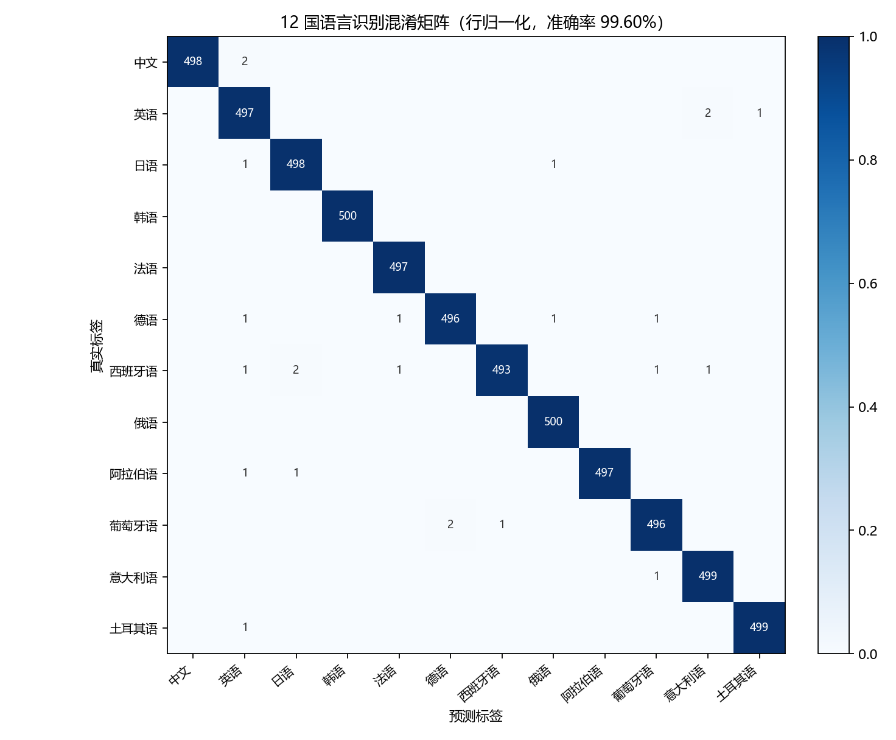

# 实验报告：基于 BERT 的 12 国语言识别

## 1. 实验目的

1. 理解「预训练 + 微调」范式：用 Transformer 结构的 BERT 预训练模型解决一个具体的文本分类任务。
2. 掌握 BERT 做句子级分类的做法：取 `[CLS]` 向量 → 全连接分类头 → softmax。
3. 完成一个可用的 12 国语言识别系统，并分析其误差来源。

## 2. 数据集

| 项目 | 说明 |
|---|---|
| 来源 | WiLI-2018（维基百科段落，235 种语言，语言识别标准公开数据集） |
| 语言种类 | 12 种：中、英、日、韩、法、德、西、俄、阿、葡、意、土 |
| 每条样本 | 一段维基百科正文，平均 240～440 字符 |
| 训练集 | 5 394 条（每语言约 450 条，从官方 train 中分层抽 90%） |
| 验证集 | 600 条（每语言 50 条） |
| 测试集 | 5 994 条（每语言约 500 条，官方 test 划分，未参与训练） |

数据预处理：合并连续空白、去掉长度 < 30 字符的样本、按文本去重、标签转成 0~11 的整数 ID。

## 3. 方法

### 3.1 模型结构

```
输入文本
  → WordPiece 分词（mBERT 词表 119 547）
  → Token Embedding + Position Embedding + Segment Embedding
  → 12 层 Transformer Encoder（每层：多头自注意力 + FFN，各带残差与 LayerNorm）
  → 取 [CLS] 位置的 768 维向量
  → Dropout + Linear(768 → 12)
  → Softmax → 12 种语言的概率
```

预训练模型：`bert-base-multilingual-cased`（12 层、768 维、12 头，约 1.78 亿参数），
在 104 种语言的维基百科上做过 MLM + NSP 预训练，本身已经见过这 12 种语言的文字，
所以微调只是「把它的语言知识对齐到 12 个类别上」。

### 3.2 训练设置

| 超参数 | 取值 |
|---|---|
| 最大序列长度 | 128（超出截断） |
| Batch size | 16 |
| 学习率 | 2e-5（AdamW，weight decay 0.01，bias/LayerNorm 不衰减） |
| 学习率调度 | 线性 warmup（10%）+ 线性衰减到 0 |
| Epoch | 3（按验证集 macro-F1 早停，patience=2） |
| 梯度裁剪 | 1.0 |
| 混合精度 | 是（AMP，fp16） |
| 随机种子 | 42 |

工程细节：

- **动态 padding**：先只截断不补齐，每个 batch 内按最长样本补齐，减少无效计算；
- **分层切分**：验证集从训练集按标签分层抽 10%，保证每类 50 条；
- **按验证集 macro-F1 保存最佳模型**，而不是按 loss。

## 4. 实验结果

### 4.1 总体指标（测试集 5 994 条）

| 指标 | 数值 |
|---|---|
| Accuracy | **99.60%** |
| Macro-F1 | **99.60%** |
| Weighted-F1 | 99.60% |
| Loss | 0.0233 |
| 错分条数 | 24 |

### 4.2 每种语言

| 语言 | P | R | F1 | 样本数 |
|---|---|---|---|---|
| 中文 | 1.0000 | 0.9960 | 0.9980 | 500 |
| 英语 | 0.9861 | 0.9940 | 0.9900 | 500 |
| 日语 | 0.9940 | 0.9960 | 0.9950 | 500 |
| 韩语 | 1.0000 | 1.0000 | 1.0000 | 500 |
| 法语 | 0.9960 | 1.0000 | 0.9980 | 497 |
| 德语 | 0.9960 | 0.9920 | 0.9940 | 500 |
| 西班牙语 | 0.9980 | 0.9880 | 0.9930 | 499 |
| 俄语 | 0.9960 | 1.0000 | 0.9980 | 500 |
| 阿拉伯语 | 1.0000 | 0.9960 | 0.9980 | 499 |
| 葡萄牙语 | 0.9940 | 0.9940 | 0.9940 | 499 |
| 意大利语 | 0.9940 | 0.9980 | 0.9960 | 500 |
| 土耳其语 | 0.9980 | 0.9980 | 0.9980 | 500 |

### 4.3 训练过程

| Epoch | train_loss | dev_loss | dev_acc | dev_macro_F1 |
|---|---|---|---|---|
| 1 | 0.6473 | 0.0356 | 0.9950 | 0.9950 |
| 2 | 0.0407 | 0.0239 | 0.9933 | 0.9933 |
| 3 | 0.0239 | 0.0208 | 0.9967 | 0.9967 |

第 1 个 epoch 验证集就到 99.5%，说明预训练模型已经具备很强的语言区分能力，
微调主要是在「校准输出类别」。总训练时间 3.7 分钟（RTX 3060）。



## 5. 结果分析

**（1）哪些语言还会错？**
24 条错分中，主要是三类：

1. **段落主体是外语**：中文维基条目里整段英文参考文献（如 "International economics (London: Nisbet…)"），模型判成英语；
2. **专有名词串**：英语条目里罗列大量意大利语、德语乐器/专辑名，判成意大利语、土耳其语；
3. **同语系近邻**：葡/西/意/法之间偶有互错，共享拉丁字母且词汇相近。

**（2）哪些几乎不会错？**
字符集差异大的语言（中、日、韩、俄、阿）几乎零错误，韩语 F1 达到 1.0000，说明字符形状是很强的特征。

**（3）置信度是否可靠？**
输入 12 条正常句子，正确类别概率都在 99% 以上；输入 `OK, 1234567890 !!!` 这种无语言特征的串，最高概率只有 47%，模型没有「强行自信」，说明 softmax 输出有一定校准性。

**（4）为什么效果这么好？**
语言识别本身是「字符分布 + 高频功能词」就能解决的任务，而 mBERT 在预训练阶段已经见过这 12 种语言的海量文本，等于把「语言模型知识」直接迁移过来了。这正是预训练范式的价值：从零训练同样数据量（5 394 条、3 个 epoch）几乎不可能到 99%。

## 6. 结论与改进方向

本实验用 mBERT + 一个 12 类分类头，在 12 种语言的维基百科段落上微调 3 个 epoch，
测试集准确率 99.60%、宏平均 F1 99.60%，验证了 Transformer 预训练模型在文本分类任务上的迁移能力。

可以继续做的：

- 扩到 20 / 100 种语言，看相近语种混淆如何变化；
- 用短句、口语、中英混说（code-switching）测鲁棒性——真实业务里文本远没有维基百科规范；
- 对比 `distilbert-base-multilingual-cased`（速度约 2 倍、精度略降）与 XLM-R；
- 蒸馏 + ONNX 量化，部署成轻量语言识别服务。
